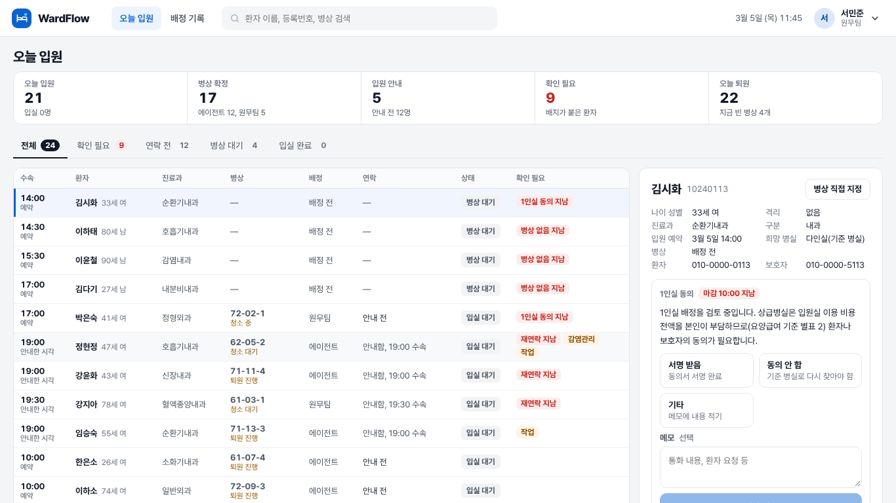
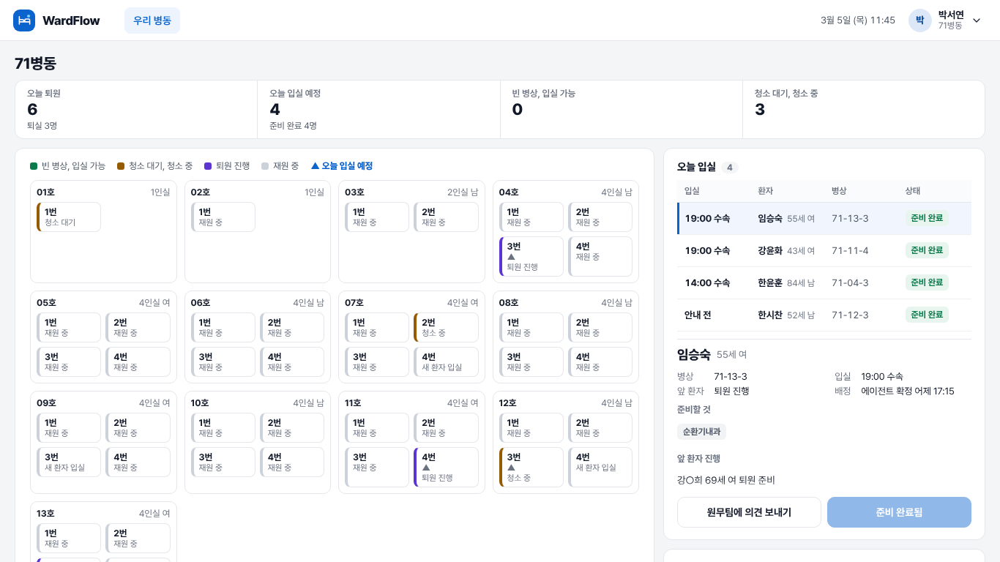

# WardFlow

[](https://github.com/Leejonghoona/wardflow-bed-agent/actions/workflows/test.yml)

퇴원부터 다음 환자 입실까지, 병상 준비 과정을 맡는 병원 운영 AI 에이전트입니다.
**LLM은 판단만 하고, 실행은 규칙과 게이트웨이가 다시 검사한 뒤에만 합니다.** 모든 데이터는 합성(가상 병원)입니다.

<p>
  
  
</p>

## 핵심 결과

모든 숫자는 합성 데이터에서 잰 값입니다. 결과 파일(`evals/results/final_1112/`)에서 다시 계산한 값과 같은지 CI가 검사합니다.

| 항목 | 결과 | 조건 |
|---|---|---|
| 실행 안전 위반 | **0 / 764** | 에이전트가 실행한 배정·청소·입실을 독립 평가기로 사후 점검. 시드 100개, 시드마다 하루 재생. 아래 표에 검사별 건수 |
| 사람 손 없이 확정 | **72.4%** | 확정 203건 중 147건 (입원 304건 대비 48%), 시드 20개 |
| 수속 → 입실 대기 | **91.8 → 78.6분** | 같은 시드 짝 비교 48쌍, 차이 95% 구간 −18.4 ~ −8.3분. 줄어든 시간 대부분은 "청소 요청 지연 제거"에서 나오고, 그 지연 크기는 설계 가정 |
| 원내 LLM 도입 시험 | **판정 4종 중 3종 통과** | H100 1장, vLLM 0.19.0, 300문항 × 3회. 대표 Gemma 4 26B, 실행된 금지 행동 0 |
| LLM 판단의 규칙표 반영 | 구현 | 담당자가 고친 답이 LLM 답과 같은 사례가 쌓이면 규칙 수정안, 책임자 승인 뒤 반영 |

안전 검사별 건수(위반/검사 수). 스트레스 재생은 격리 퇴실을 날마다 넣은 시드 400개로, 분모를 키우려고 따로 돌렸습니다.

| 검사 | 본 측정 | 스트레스 재생 | 합친 95% 상한 |
|---|---|---|---|
| S1 격리·성별 배정 | 0/225 | 0/826 | 0.28% (0/1051) |
| S2 종말소독 누락 | 0/27 | 0/400 | 0.70% (0/427) |
| S3 청소 전 빈 병상 전환 | 0/335 | 0/1285 | 0.18% (0/1620) |
| S4 한 병상 두 환자 | 0/177 | 1/710 | 아래 설명 |

S4의 1건은 에이전트가 빈 병상에 환자를 확정한 뒤, 미리 짜 둔 다음 날 퇴원 일정이 같은 병상에 다른 환자가 있다고 알린 사례입니다. 재생 방식의 한계로 판단했지만 위반 건수에서 빼지 않았습니다. 병원 시스템 기록과 에이전트 배정이 어긋나는 것을 알아채는 기능은 아직 없습니다(`docs/DECISIONS.md` 2026-11-12).

## 쓰임새와 검증 상태

병상 배정 업무를 돕는 운영 도구의 시연용 구현입니다. 진단·치료 판단에 쓰는 것이 아니고, 실제 환자 정보로 돌린 적이 없습니다. 의료기기 해당 여부는 판단하지 않았습니다.

| 무엇을 | 어디까지 확인했나 |
|---|---|
| 안전 규칙이 실행 단계에서 지켜지는가 | 합성 데이터 재생으로 측정 (위 표) |
| 대기 시간이 줄어드는가 | 합성 데이터에서만. 효과 크기는 설계 가정에 기댑니다 |
| 현직자가 보기에 맞는가 | **확인 0건.** 설문을 보냈고 답은 아직 없습니다 |
| 실제 병원 데이터에서 되는가 | **해 보지 않았습니다.** HL7 표본 36건도 직접 쓴 것입니다 |
| 정답 라벨이 맞는가 | 작업자 규칙으로 만들었고, 사람은 1명이 15문항만 검토했습니다 |
| 검수 | 직무별 AI 페르소나 10개가 두 번 했습니다. 사람 검수는 없습니다 |
| 누가 만들었나 | 코드와 문서 대부분을 Claude Code가 썼습니다. 방향과 결정은 사람이 했고 [`docs/AI-DD.md`](docs/AI-DD.md)에 나눠 적었습니다 |

## 구조

```
병원 사건 → 사건 저장소 → 사례 흐름(사가) → 판단(병상: 점수 규칙 / 예외: 규칙표, LLM은 기록·제안)
        → 실행 게이트웨이(제안 때·확정 직전 재검사) → 원무팀 · 병동 · 감염관리실 · 청소
```

- **판단과 실행 분리:** 병상은 점수 규칙으로 정하고, 모든 실행은 게이트웨이를 거칩니다. 연락·확정 뒤 재배정 같은 행동은 코드 상수로 잠겨 병원 설정으로도 풀 수 없습니다.
- **단계별 맡김:** 사람 결정 25건 이상, 일치율 신뢰 하한 85% 이상인 유형만 에이전트가 확정하고, 최근 20건 중 3건이 고쳐지면 다시 사람에게 돌아갑니다.
- **휴먼 인 더 루프:** LLM 예외 판단은 실행하지 않고 기록합니다. 담당자가 규칙표 답을 고쳤고 그 답이 LLM과 같은 사례만 세어 규칙표 수정안을 만듭니다(`src/turnaround/agent/rule_learning.py`).
- **병원 데이터 연결:** 열 이름이 다른 EMR 표를 공통 사전(온톨로지)에 연결하고, 모르는 열은 추측하지 않고 묻습니다.

## 실행

```bash
docker build -t wardflow . && docker run -p 8000:8000 -v wardflow-data:/data wardflow
```

http://localhost:8000 에서 **시연 화면**(대표 사례 3개)이나 **운영 화면**(역할 계정, 데모 비밀번호 `demo1234`)을 고릅니다.
기본은 API 키 없이 도는 결정적 규칙표입니다. 실제 모델은 `TURNAROUND_LLM=openai|anthropic|local`로 붙입니다.

```bash
pip install -e ".[dev,api]" && python -m pytest -q   # 전체 시험
```

## 한계

- 합성 데이터만 썼습니다. 단계별 소요 시간과 행동 효과 크기는 공개 자료를 참고한 설계 가정이고, 현직자 검증 전입니다.
- 재생은 미리 짜 둔 퇴원 일정에 에이전트 배정을 얹는 방식이라, 에이전트가 채운 병상에 다음 날 다른 환자의 퇴원 사건이 나올 수 있습니다.
- 병상 수 예측 구간은 단계 분포가 그 병원과 같을 때만 맞습니다. 분포가 달라지면 준비 병상을 많게 보는 쪽으로 어긋나고, 보정 검사(PIT)가 이를 잡아냅니다.
- 비말주의 퇴실의 환기 대기는 기본으로 걸지 않습니다(국내 지침은 약한 권고, 병원 설정으로 켭니다).
- 담당자 결정은 모의 모형입니다. 로그인·신원 인증은 없습니다.
- HL7 v2 ADT 입력은 직접 쓴 표본 메시지 36건으로만 시험했고(틀린 연결 0, 질문 7건), FHIR 내보내기는 R4 구조 검증까지만 했습니다. 실제 병원 메시지와 KR Core 프로필 검증은 하지 않았습니다.
- 원내 LLM 시험은 원내 조건을 재현한 임대 GPU에서 쟀습니다. 정답 차이는 사전 등록 기준 보정 후 유의하지 않습니다.

## 근거 문서

| 문서 | 내용 |
|---|---|
| [`docs/DECISIONS.md`](docs/DECISIONS.md) | 설계 결정과 이유 (날짜순) |
| [`docs/RESULTS.md`](docs/RESULTS.md) | 측정 기록과 재현 조건 |
| [`docs/검토/LLM도입_인수시험_설계_초안.md`](docs/검토/LLM도입_인수시험_설계_초안.md) | 원내 LLM 도입 시험 사전 등록과 GPU 판정(16절) |
| [`docs/AI-DD.md`](docs/AI-DD.md) | AI·규칙·사람의 역할 분담 |

<details>
<summary>MCP 연결, 에이전트 추적</summary>

조회 전용 도구 6개를 MCP 서버로 엽니다(상태를 바꾸는 도구는 없음).

```bash
pip install -e ".[api,mcp]"
python -m turnaround.mcp_server          # stdio
claude mcp add wardflow -- python -m turnaround.mcp_server
```

LLM 호출, 판단, 게이트웨이 판정을 OpenTelemetry span으로 남깁니다.

```bash
pip install -e ".[trace]"
TURNAROUND_TRACE=1 TURNAROUND_TRACE_FILE=traces.jsonl uvicorn turnaround.api.app:app
```
</details>
