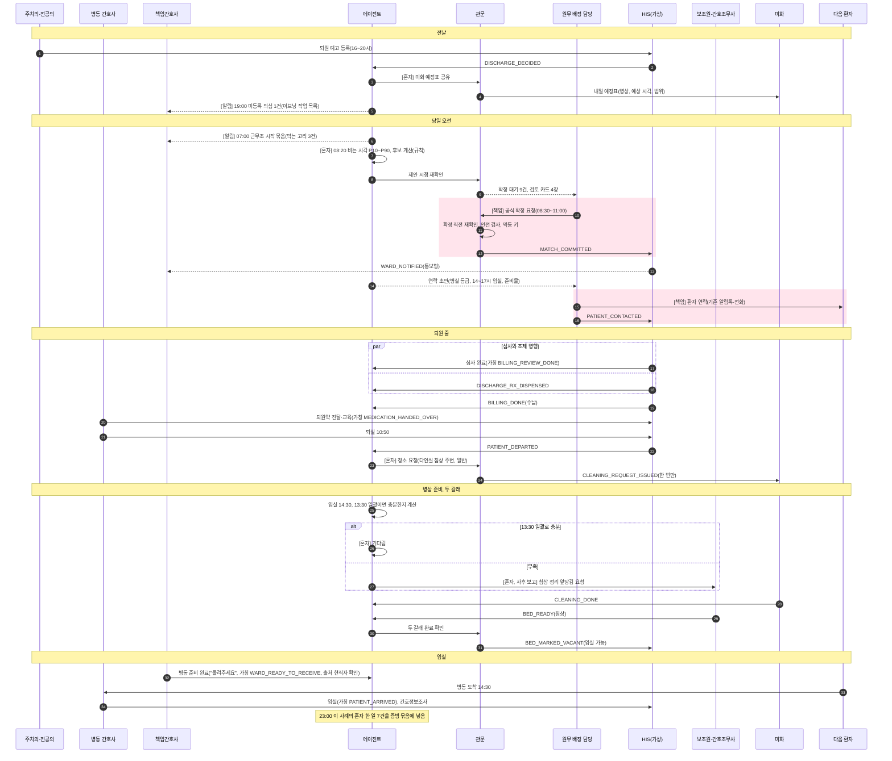
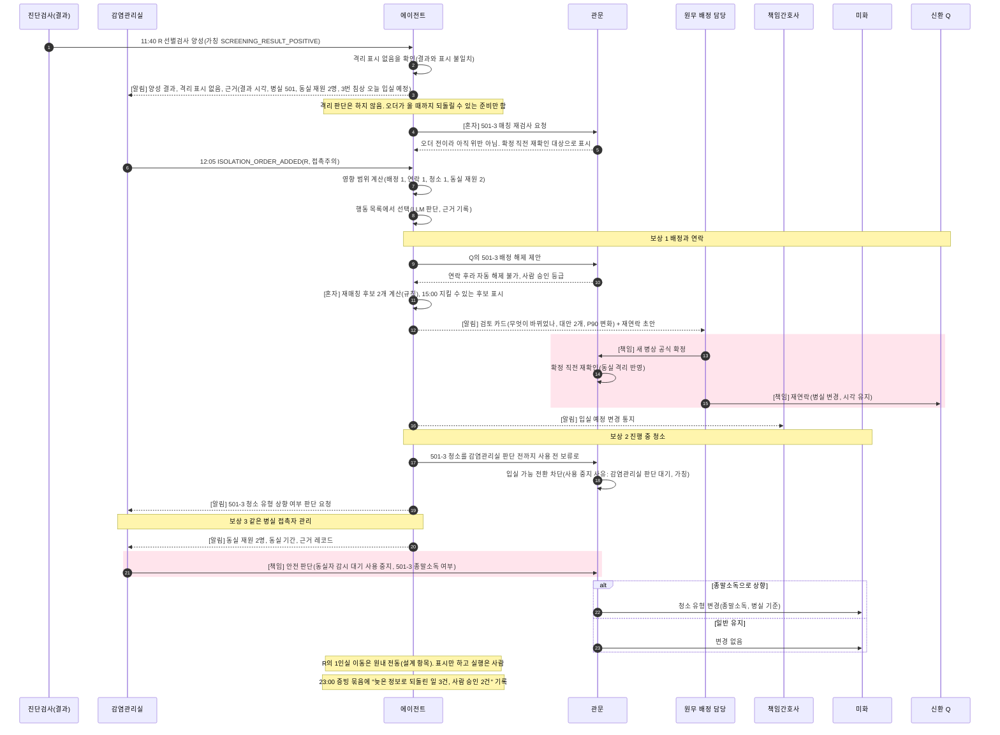
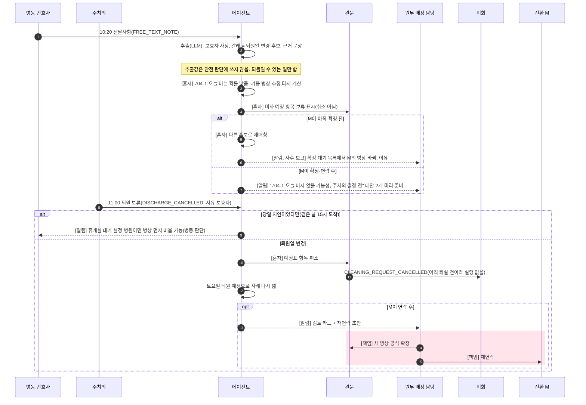
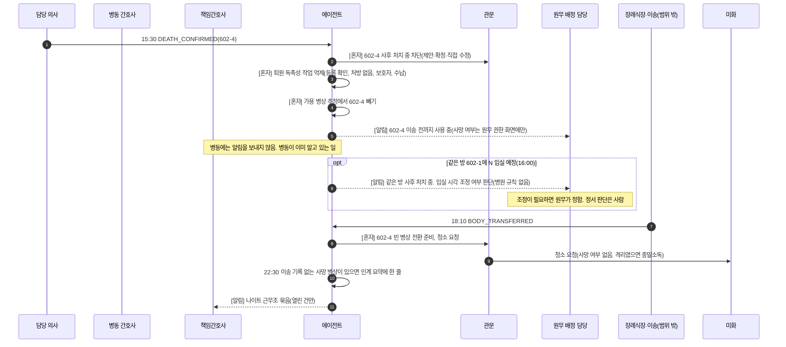
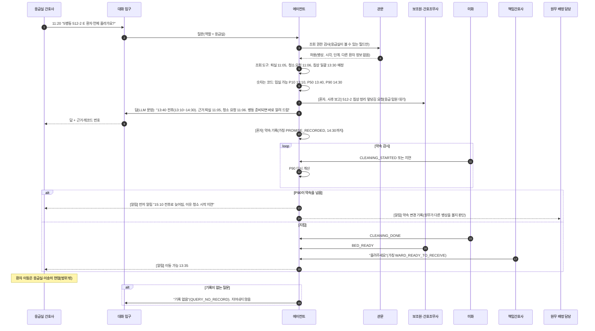
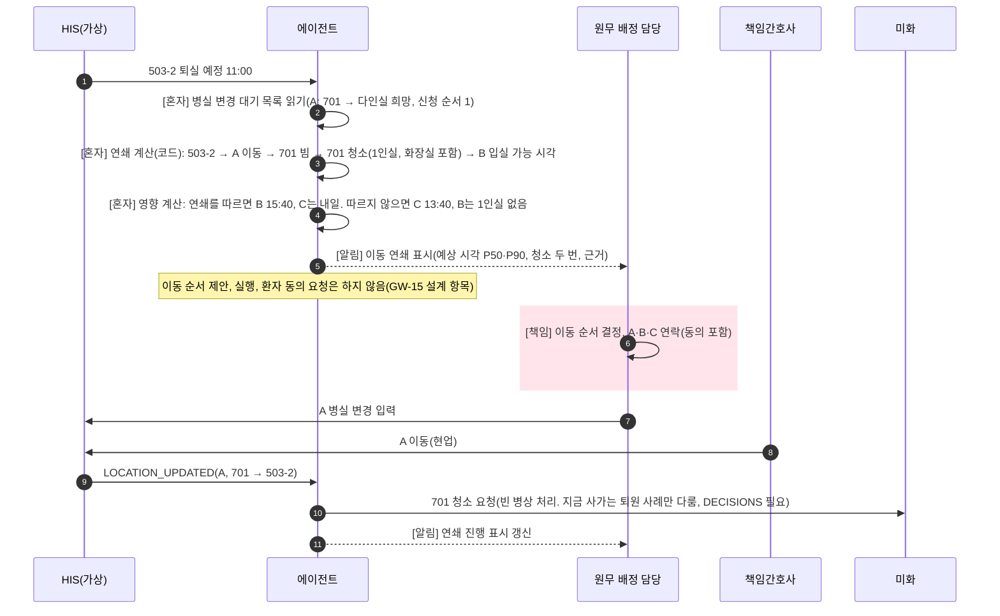

# 사용자 흐름 개정안: 책임 순간만 남기는 위임 에이전트

- 작성일: 2026-11-09. 작성: 작업자(헬스케어 서비스 UX 리서처 겸 업무 흐름 설계자 관점). 상태: **개정안(사용자 승인 전)**. 이 문서는 코드, 시나리오, DECISIONS, SPEC, `docs/기획/`을 고치지 않는다. 7절의 갱신 목록은 사용자가 승인한 뒤 해당 문서에 반영한다.
- 입력(모두 읽음): `CLAUDE.md`, `docs/기획/병상사이클_지도.html`(합의된 현실 사이클), `docs/기획/02_사용자_이해관계자.md` v0.7, `docs/기획/04_PRD.md` v0.7, `docs/DECISIONS.md` 2026-11-09 항목(현장 조사 반영 A~H와 청소 두 갈래, 입실 가능 기준의 청소 범위, 격리 정보 처리 정정, 선제 격리는 알림으로, 남녀 병실 구별 법령 금지, U8 확장, 합성 병원 기간 10일, 병실 이동 연쇄 표시), `docs/검토/차별점/최종_방향안.md`, `docs/검토/차별점/에이전트혁신.md` 개념 8, `docs/검토/AX수요/엔드픽처_정렬.md` 3절, `docs/검토/현장조사/종합.md`·`EMR_병상관리.md`·`유튜브_요약_A/B/C.md`, `src/turnaround/ui/app.py`·`demo.py`, 설계 문서의 "업무 재설계"·"사람 개입"·"화면 목업" 절.
- 표기: 근거 등급은 `종합.md` "출처를 읽는 법"을 따른다. **[1차]** 법령·판결·지침·병원 공식 안내·과업지시서, **[QI]** 질 향상 보고·논문, **[영상]**·**[블로그]** 현장 의견(존재 증거만, 빈도 근거 아님). 근거가 없는 시각·절차·채널은 **(설계 가정)**, 현장에서만 답할 수 있는 것은 **(현직자 확인)**. 시각과 소요는 모두 합성 데이터 기준이며 병원 발표 수치와 비교하지 않는다(CLAUDE.md 6번).
- 사건 이름: 이미 코드에 있는 사건은 그대로 쓴다(예: `PATIENT_DEPARTED`, `ISOLATION_ORDER_ADDED`, `DEATH_CONFIRMED`, `BODY_TRANSFERRED`, `QUERY_ANSWERED`). 새로 필요한 사건은 **(가칭)**을 붙였다. 새 사건은 구현 전에 DECISIONS에 먼저 적는다.

## 결론 먼저

1. **주 사용자는 둘이다.** 원무 병상 배정 담당(주간 입원원무, 야간은 원무 응급지원 단위가 하는 병원이 있음 [1차 1건])과 병동 책임간호사. 둘의 하루는 "당일 오전 배정 → 11시 퇴실 → 13:30 침상 정리 → 14~17시 입실"이라는 현장 리듬 위에 놓는다. 전날 17:00 사전 매칭 장면은 기본 흐름에서 뺀다(DECISIONS B).
2. **사람이 손대는 곳은 세 책임 순간뿐이다.** 공식 확정(원무), 환자 연락(원무가 내용을 정하고 기존 알림톡·전화로 보냄), 안전 예외(감염관리실). 그 밖의 사람 행동(퇴원 결정, 처방, 격리 오더, 사망 확인, 청소, 침상 정리, 이동)은 **원래 하던 현업**이고, 에이전트는 그 흔적을 **듣는다**. 새 확인 버튼을 만들지 않는다.
3. **에이전트 행동은 세 층이다.** 혼자 한다(정보 공유, 시각 재계산, 청소 요청, 연락 전 보상, 약속 기록), 알린다(원래 일이 바뀐 사람에게만, 근거 붙여), 사람에게 넘긴다(책임 순간과 되돌릴 수 없는 일). 예외 때 무엇을 할지는 LLM이 **정해진 행동 목록** 안에서 고르고, 관문이 검사한다(U8 확장). 병상 선택과 숫자는 결정적 코드다.
4. **간호사 입력 부담은 늘리지 않는다.** 에이전트는 간호사에게 묻지 않는다(개념 8 미채택). 근무조 시작에 "다음 환자를 막는 고리" 몇 줄만 보낸다. 받을 수단이 없는 신호(예: "올려주세요")는 기능을 끄는 쪽으로 설계한다.
5. **여섯 핵심 흐름**을 시퀀스 다이어그램으로 그렸다: (a) 정상 하루, (b) 늦게 온 격리 양성 결과, (c) 보호자 퇴원일 변경, (d) 병동 사망, (e) 응급실의 "언제 올려요?"(대화 입구), (f) 병실 이동 연쇄 표시.
6. **채널**: 대화창은 입구이고 조회는 에이전트의 도구다. 원내 메신저·EMR 작업 목록 연동은 국내 근거 0건이라 전부 **설계 가정**이다. 데모는 Streamlit 화면 안의 대화창과 역할별 알림 패널로 흉내 낸다.
7. **화면 개정**: 첫 화면을 "관문이 막은 것과 늦은 이유"로 바꾸고, 사례 타임라인(두 줄 사이클), 매일 밤 증빙 묶음, 이동 연쇄 표시, 대화 입구를 더한다. 데모 장면 D1~D5에 하나씩 대응시켰다(6.8).
8. **02·04 갱신**: 페르소나 2개 추가(응급실 간호사 PS-11, 간호조무사·병동 보조원 PS-12), PS-4·PS-7·PS-3 고침, RACI 26행 변경(신규 12, 수정 13, 삭제 1), 여정 4.1·4.2 다시 씀, 기존 스토리 18개 수정, 새 스토리 14개(US-27~US-40) 제안.
9. **사용자 결정이 필요한 것 14개, 현직자만 답할 수 있는 것 12개**를 8절에 적었다. 가장 급한 것은 "올려주세요" 신호의 출처, 침상 정리 앞당김 요청을 에이전트가 보조원에게 직접 보내도 되는지, 연락 초안을 구현 범위로 끌어올릴지다.

---

## 0. 새 설계가 바꾸는 흐름의 전제

| # | 예전 흐름(02·04 v0.7) | 새 흐름 | 근거 |
|---|---|---|---|
| P1 | 전날 17:00 사전 매칭 초안, 담당이 모두 확인 | **입원 당일 08:30~11:00 원무 배정.** 에이전트는 08:20까지 "확정 대기" 목록과 검토 카드를 준비. 전날 가배정은 병원 옵션 | DECISIONS B, 공개 안내 14곳 [1차] |
| P2 | 병동 수용 회신이 없으면 확정 거부(GW-4) | **통보형 기본.** 원무 확정 → 병동 통보 → 병동은 이의 제기나 "잠시만" → 준비되면 "올려주세요". 회신형은 병원 설정 | DECISIONS C, 서울고법 2013누25193 [1차], [영상] 42PmvzZL8Mo |
| P3 | 퇴원약 준비 뒤 심사·수납(직렬) | **심사 ∥ 조제 → 수납 → 영수증 확인 → 약 전달·교육 → 퇴실(규정 11시)** | DECISIONS D, 서울성모·강북삼성 안내 [1차] |
| P4 | 보호자 지연 = 당일 시각 지연 | **두 갈래**: 당일 지연(휴게실 대기 설정이면 병상 먼저 비움) / 퇴원일 변경(보류 경로) | DECISIONS E, 서울성모 중앙휴게실 [1차], [영상] k5YQLMj0sMk |
| P5 | 청소 = 환경관리 한 곳, 완료 신호 = 사용 가능 | **두 갈래**: 보조원·간호조무사 침상 정리(13:30 일괄 또는 퇴실 직후) + 미화 표면 청소. 둘 다 끝나야 입실 가능. 다인실은 그 침상 주변, 1인실은 화장실까지, 격리 퇴실은 병실 전체 종말소독 | DECISIONS 청소·청소 범위, 해운대백 과업지시서 [1차], 동아대 시연 [영상] |
| P6 | 선별검사 결과 대기 = 1인실 또는 사람 확인 | **결과 대기는 일반 배정.** 늦게 온 양성은 보상 단계. 결과와 격리 표시가 어긋나면 감염관리실에 알림 | DECISIONS 격리 정보 처리 정정, QIH 2022 53% [QI] |
| P7 | 선제 격리 = 담당 검토(1인실만) | **근거 붙은 알림**(과거력·고위험 조건). 격리 여부와 병실은 사람이 정함 | DECISIONS 선제 격리는 알림으로 |
| P8 | 성별 병실 예외 = 사유 입력 후 진행, 수간호사 사후 검토 | **법령 금지.** 예외 단서 없음. 사후 검토 흐름 삭제 | DECISIONS 남녀 법령, 의료법 시행규칙 제35조의2제2호 [1차] |
| P9 | 예외면 사람에게 올림 | **정해진 행동 목록 중 LLM이 고르고 관문이 검사.** 실패하면 사람에게 올림 | DECISIONS U8 확장 |
| P10 | 원내 전동 = 설계(보이지 않음) | **이동 연쇄를 표시만.** 순서·동의·실행은 사람 | DECISIONS 병실 이동 연쇄 표시, 5개 병원 안내 [1차] |
| P11 | 정체성: 관제 에이전트(L2 제안) | **책임 순간만 남기는 위임 에이전트, 관문과 재생 증명 내장. 대화창은 입구** | DECISIONS U8 확장, 최종 방향안 4절 |

---

## 1. 행동의 세 층과 책임 순간

### 1.1 세 층

| 층 | 뜻 | 사람이 아는 방법 | 예 |
|---|---|---|---|
| **혼자 한다** | 관문을 통과하면 사람 없이 실행. 되돌릴 수 있는 일만 | 매일 밤 증빙 묶음(다음 날 아침). 원래 일이 바뀌는 사람이 있으면 그 사람에게만 알림 | 준비 시각 재계산, 미화 예정표 공유, 퇴실 즉시 청소 요청, 연락 전 배정 해제, 약속 기록 |
| **알린다** | 사람의 원래 일이 바뀌었거나 사람이 알아야 다음 일을 할 수 있을 때 한 번 | 그 사람이 이미 보는 곳(작업 목록, 인계, 원무 화면). 연동 수단은 설계 가정 | 입실 예정 변경 통지, 양성 결과와 격리 표시 불일치, 연기 판단이 필요한 사례 |
| **넘긴다** | 책임 순간과 되돌릴 수 없는 일. 에이전트는 근거와 초안까지만 | 검토 카드, 확정 대기 목록, 안전 예외 카드 | HIS 공식 확정, 환자 연락, 안전 예외 승인 |

### 1.2 책임 순간 세 개 (바뀌지 않음)

| 책임 순간 | 누가(A) | 에이전트가 하는 일 | 에이전트가 하지 않는 일 |
|---|---|---|---|
| **공식 확정** | 원무 병상 배정 담당 | 후보 계산(규칙), 근거, 확정 직전 재확인(관문), 확정 대기 목록 | HIS 쓰기 |
| **환자 연락** | 원무 | 연락 대상과 사유를 결정적으로 고르고, 안내 문구 초안(병실 등급, 입실 시각 구간, 연기 사유)을 LLM이 씀 | 발송. 발송은 기존 HIS 알림톡·ARS·전화 [1차: 서울대·서울성모·용인세브란스 알림톡] |
| **안전 예외** | 감염관리실(야간 대행은 병원 설정, 설계 가정 MA-01) | 금지는 관문이 막음. 사전 승인이 필요한 건은 근거·대안과 함께 카드로 | 격리 판단, 격리 오더 |

환자 연락의 경계: 예전 문서는 "환자 연락 = 사람이 전화"로 읽혔다. 새 흐름은 "**연락 내용 확정 = 원무, 발송 = 기존 알림톡**"이다(`종합.md` (b) 20번). 자동 발송은 여전히 설계 항목이라 하지 않는다(04 2.2 비목표).

### 1.3 책임 순간이 아닌 사람 행동 (현업 그대로, 에이전트는 듣기만)

| 사람 행동 | 누가 | 에이전트가 받는 사건 |
|---|---|---|
| 퇴원 결정·예고, 퇴원 처방, 처방 수정 | 주치의·전공의 | `DISCHARGE_DECIDED`, `DISCHARGE_RX_ISSUED`, `DISCHARGE_RX_REVISED` |
| 격리 오더, 해제 | 주치의·감염관리실 | `ISOLATION_ORDER_ADDED`, `ISOLATION_RELEASED` |
| 사망 확인, 안치실 이송 | 담당 의사, 장례식장 | `DEATH_CONFIRMED`, `BODY_TRANSFERRED` |
| 전달사항·보호자 통화 메모 | 병동 간호사 | `FREE_TEXT_NOTE` → `FIELDS_EXTRACTED` |
| 병동 이의 제기, "잠시만", "올려주세요" | 책임간호사 | `WARD_REJECTED`(이의), `WARD_READY_TO_RECEIVE`(가칭) — 신호 출처는 (현직자 확인) |
| 침상 정리, 표면 청소 | 보조원·간호조무사, 미화 | `BED_READY`, `CLEANING_DONE` — 완료 입력 수단은 국내 근거 0건 (현직자 확인) |
| 병실 이동 실행 | 원무·병동 | `LOCATION_UPDATED` |

### 1.4 정해진 행동 목록과 자율 단계 (제안, 설계 가정)

U8 확장 결정은 "행동마다 자율 단계(자동 / 사후 보고 / 사람 승인)를 정책 파일에 둔다"고 했다. 아래는 그 기본값의 **제안**이다. 값은 사용자 확인 뒤 DECISIONS에 적는다(8.1 U3).

| 행동 | 예 | 자율 단계(기본 제안) | 관문 검사 | 실패 시 |
|---|---|---|---|---|
| 정보 공유 | 수납 대기 공유, 예정표 공유 | 자동 | 정보 최소화(SEC-2), 사망 여부 비노출 | 없음 |
| 다시 계산 | 준비 시각·가용 병상 P10~P90 | 자동(코드) | 해당 없음 | 이전 값 유지 |
| 다시 요청 | 청소 미시작이 기준 초과 → 미화에 한 번 더 | 자동, 사례당 1회 | 멱등 키 | 올림 |
| 앞당김 요청 | 입실이 급하면 13:30 일괄 대신 침상 정리 먼저 | **사후 보고** | 같은 근무조 요청 상한(설계 가정) | 기다림 |
| 기다림 | 타이머 재설정, 다음 사건 대기 | 자동 | 마감 초과 시 올림 | 올림 |
| 재매칭 제안 | 확정 전 다른 병상 | 사후 보고(확정 대기 목록이 바뀜) | 제안 시점 재확인, 안전 3단계 | 올림 |
| 보상 실행(연락 전) | 배정 해제, 청소 예정 취소 | 자동(기존 SAG-4) | 보상 순서 검사 | 올림 |
| 보상 실행(연락 후) | 배정 변경 | **사람 승인**(원무) + 재연락 작업 | 확정 직전 재확인 | 해당 없음 |
| 올림 | 담당자에게 근거와 함께 | 자동 | 수신자 역할 매핑 | 상위 담당 |
| 연락 초안 | 원무가 보낼 안내 문구 | 자동(초안만) | 초안의 사실 필드 = 도구 값 | 규칙 문장 |
| 약속 기록·먼저 알림 | 응급실에 답한 시각을 지키는지 감시 | 자동 | 근거 레코드 필수 | "기록 없음" |
| 공식 확정, 환자 연락 발송, 안전 예외 | | **항상 사람** | | |
| 격리 판단, 병실 이동 순서·실행, 퇴원 결정 | | **범위 밖**(사람의 현업) | | |

---

## 2. 사용자

### 2.1 주 사용자

| ID | 사용자 | 에이전트에게 맡기는 것 | 남는 것(책임 순간) | 보는 곳 | 근거 |
|---|---|---|---|---|---|
| PS-1 | **원무 병상 배정 담당(주간)** | 비는 시각 추정, 후보 계산, 재확인, 재매칭, 연락 전 보상, 연락 초안, 문의 응답 | 공식 확정, 환자 연락(내용), 판단 카드 | 원무 화면(확정 대기·검토 카드·연락 초안), 대화 입구, 첫 화면 | LP-25, 순천향 규정·서울성모 입원원무팀 [1차] |
| PS-2 | 원무 병상 배정 담당(야간·휴일) | 같음 + 인계 요약 | 같음 | 같음 | 서울성모 응급지원Unit [1차 1건], AS-A2 부분 확인 |
| PS-3 | **병동 책임간호사(근무조)** | 퇴원 진행 추적, 처방 없음 감지, 청소 요청, 침상 정리 앞당김, 입실 예정 변경 반영 | 이의 제기·"잠시만"·"올려주세요"(현업), 회신형 병원이면 수용 회신 | 근무조 시작 "다음 환자를 막는 고리" 몇 줄, 입실 예정 목록 | 판결 [1차], [영상] 0yyoWJEQnMg·42PmvzZL8Mo |

### 2.2 보조 사용자

| ID | 사용자 | 에이전트와 닿는 곳 | 바뀌는 점 | 근거 |
|---|---|---|---|---|
| PS-11(신규) | **응급실 간호사** | 대화 입구에 "언제 올라가요?"를 묻고 근거 붙은 시각 구간을 받음. 약속이 깨질 것 같으면 먼저 알림 | 병동·원무에 거는 확인 전화가 줄 것을 기대(미측정). 응급실 내부 배치는 범위 밖 | [영상] 42PmvzZL8Mo "자꾸 좀 있다 올리래", 아산 하루 250건 [1차 소식지], DECISIONS 응급실 범위 |
| PS-4 | **병동 간호사** | 전달사항·보호자 메모를 쓰던 대로 씀. 에이전트가 추출 | 새 입력 0. 보호자 퇴원일 변경을 따로 알리지 않아도 됨 | [영상] k5YQLMj0sMk |
| PS-8 | **감염관리실** | 양성 결과-격리 표시 불일치 알림, 과거력 근거 알림, 같은 병실 접촉자 목록, 안전 예외 카드 | 선제 격리 검토 카드가 알림으로 바뀜. 결정은 그대로 사람 | DECISIONS 격리 정정·선제 격리 알림, [영상] rcy4ku34xm0 |
| PS-7(이름 변경) | **미화(직영·외주)** | 전날 예정표, 퇴실 시 한 번 오는 요청(병상, 시작 가능 시각, 범위, 유형) | 범위(침상 주변 / 화장실 포함 / 병실 전체 종말소독)가 요청에 붙음. 환자 정보 없음 | 동아대 시연 [영상], SEC-2 |
| PS-12(신규) | **간호조무사·병동 보조원** | 13:30 일괄 목록, 입실이 급한 병상의 앞당김 요청 | 침상 정리가 별도 단계로 추적됨 | 해운대백 과업지시서 [1차] |

PS-9(수간호사)는 주 사용자에서 **상위 담당**으로 내린다. 마감 넘긴 병동 작업의 에스컬레이션 수신, 급변 전동 병상 잡아 두기, 소아·중환자실 하향 판단에서만 닿는다. PS-5(수납 원무), PS-6(약제부), PS-10(담당 의사)는 바뀌지 않는다.

---

## 3. 직무별 하루 흐름

합성 병원 하루를 현장 리듬에 맞춰 놓았다. 열 "에이전트 혼자"는 사람에게 묻지 않고 하는 일, "알림"은 받는 사람과 채널, "책임 순간"은 사람이 해야만 하는 일이다. 굵은 글씨가 책임 순간이다.

### 3.1 기준 시각표

| 시각 | 현장 기준 | 근거 |
|---|---|---|
| 전날 16:00~20:00 | 주치의 퇴원 예고 전산 등록 마감 | 해운대백 16시, 양산부산대 17·20시 [QI] |
| 전날 19:00 | 미등록 점검, 미화 예정표 | AS-B3 부분 확인(설계 가정 시각) |
| 07:00 / 15:00 / 23:00 | 교대(병원마다 다름, 14~15시 겹침 있음) | `operations.yaml` (설계 가정), [블로그]·[영상] |
| 08:00 | 간호사 퇴원 당일 전산 등록 마감 | 해운대백 [QI] |
| 08:30~11:00 | 원무 당일 배정 | 세브란스 등 14곳 [1차] |
| 08:30~13:00 | 환자 연락(알림톡·ARS·전화) | [1차] 다수 |
| 09:00~11:00 | 진료비 최종 심사(조제와 병행), 9~10시 수납 문자 | 서울아산·서울성모 [1차], [영상] k5YQLMj0sMk |
| 09:00 | 처방 없음 확인(기존 11:00에서 앞당김 검토) | AS-B5 반박 근거, 지도 "◐ 알림 시각 수정" (설계 가정) |
| 10:00 또는 12:00 | 연기 연락 마감(병원 설정) | 세브란스 10시, 아산 정오 [1차] |
| 11:00 | 퇴실 규정 | 6개 병원 이상 [1차] |
| 13:30 | 퇴원 침상 정리·신환 침상 준비 일괄 | 해운대백 과업지시서 [1차] |
| 14:00~17:00 | 입실 창 | 서울성모 등 [1차], 해운대백·소화기내과 QI |
| 17:30~18:00 | 입원 창구 마감, 이후 응급실 원무 창구 | 서울대 09~18, 건국대 17:30 [1차] |
| 23:00 | 매일 밤 증빙 묶음 생성 | (설계 가정) |

### 3.2 PS-1 원무 병상 배정 담당 (주간)

| 시각 | 현장에서 일어나는 일 | 에이전트 혼자 | 알림(받는 사람, 채널) | 책임 순간 |
|---|---|---|---|---|
| 전날 19:00 | (퇴근 뒤) | 내일 퇴원 예고 수집, 미등록 의심 병상 점검, 미화 예정표 공유 | 이브닝 책임간호사 작업 목록에 한 줄(미등록 확인) | - |
| 08:00 | 병동 퇴원 등록 마감 | 오늘 비는 병상과 시각(P10~P90) 계산, 선제 격리 대상의 과거력 근거 정리 | 감염관리실: 과거력 근거 알림(해당자만) | - |
| 08:20 | 출근 전 | 오늘 입원 예정자마다 후보(규칙)·제안 시점 재확인. **확정 대기**(근거만 훑으면 되는 건)와 **검토 카드**(판단 필요)로 나눔 | 원무 화면: "확정 대기 9, 검토 4" | - |
| 08:30~11:00 | 당일 배정 | 확정 직전 재확인, 동시 확정 차단 | - | **공식 확정**(HIS) |
| 확정 직후 | 병동 통보 | 통보 사건 기록, 연락 초안 작성 | 책임간호사: 입실 예정 목록 갱신 | **환자 연락**(초안 확인 후 알림톡·전화) |
| 09:00~11:00 | 심사 ∥ 조제, 수납 | 수납 대기 기준 초과 시 공유 | 수납 원무(병동원무 매니저가 있는 병원은 그쪽): 다음 환자 대기 | - |
| 09:30(마감 30분 전) | 연기 판단 | 오늘 입실이 어려운 사례와 근거 계산, 연기 안내 초안 | 원무: "연기 판단 필요 2건" | **환자 연락**(연기) |
| 10:40 | 보호자 지연 메모 | 추출, 갈래 판정(당일 지연/퇴원일 변경), 재계산. 연락 전이면 재매칭 후 확정 대기 목록 갱신 | 원무: 바뀐 안 1건(사후 보고) | 확정 뒤였다면 **재확정·재연락** |
| 11:20 | 응급실 문의 | 대화 입구 답, 약속 기록 | 응급실 간호사 | - |
| 12:05 | 늦은 격리 양성 | 보상(흐름 b) | 원무: 재연락 작업과 초안 | **재확정·재연락**, 감염관리실 **안전 예외** |
| 13:00 | 질문 | 대화 입구: "오늘 15시 전에 입실 못 할 사례와 이유?" | - | - |
| 14:00~17:00 | 입실 창 | 입실 가능 판정, "올려주세요" 듣기, 입실 기록 | - | - |
| 17:30 | 창구 마감 | 미결 검토·연락 인계 요약 | 야간 담당(원무 응급지원) | - |
| 다음 날 08:00 | 출근 | 증빙 묶음 요약 3줄 | 원무 책임자 | 자율화 승격·강등 서명(정책 승인자) |

**사라지는 일**: 병동에 "몇 시쯤 비나요" 전화, 응급실의 "언제 올려요" 전화 중계, 연락 뒤 재배정이 생길 때 무엇이 바뀌었는지 다시 맞추는 일(에이전트가 바뀐 것과 근거를 정리). **남는 일**: 확정, 연락, 판단 카드.

### 3.3 PS-3 책임간호사 (데이·이브닝)

| 시각 | 현장에서 일어나는 일 | 에이전트 혼자 | 알림(받는 사람, 채널) | 사람(현업 또는 책임) |
|---|---|---|---|---|
| 07:00 데이 인계 | 인계장·카덱스로 퇴원·입실 확인 [영상] | 오늘 병동 퇴원 사례 상태 정리 | **근무조 시작 묶음**: "다음 환자를 막는 고리 3건(퇴원 처방 미입력 1, 보호자 도착 미정 2)" (채널 설계 가정) | - |
| 08:00 | 퇴원 등록 | 미등록 병상 재확인 | (전날 미확인 건만) | 병동 등록(현업) |
| 09:00 | 처방 없음 | 처방·조제·심사 진행 추적 | 처방 없음 1건(전공의에게 연락할 일) | 담당 의사에게 연락(현업) |
| 09:00~11:00 | 퇴원 교육, 보호자 통화, 전달사항 기록 | 전달사항 추출(보호자 갈래) | 없음(간호사가 쓴 것을 되묻지 않음) | 교육·보호자 연락(현업) |
| 09:30~10:30 | 원무 배정 통보 | 입실 예정 목록 갱신 | 입실 예정 목록(통보형). 회신형 병원이면 수용 문의 | 이의 제기·"잠시만"(현업, 필요할 때만) |
| 11:00 | 퇴실 | 퇴실 인지 즉시 미화 요청(범위·유형 포함) | 없음 | 퇴실 처리(현업) |
| 11:30 | 입실 15:00 사례, 침상 정리 13:30 일괄 | 13:30 일괄로 충분한지 계산. 부족하면 보조원에게 앞당김 요청(사후 보고) | (앞당김 했을 때만) 근무조 묶음에 한 줄 | - |
| 13:30 | 일괄 침상 정리 | 침상·미화 두 갈래 완료 추적, 입실 가능 판정 | 없음 | - |
| 14:00~15:00 | 데이·이브닝 겹침 | 열린 작업 인계 | 이브닝 책임간호사 근무조 시작 묶음 | - |
| 15:00~17:00 | 신환 입실(이브닝에 몰림 [영상]) | 입실 기록, 응급실 약속 감시 | 응급실 간호사에게 "이동 가능"(병동이 준비 신호를 보낸 뒤) | "올려주세요"(현업), 간호정보조사(현업) |
| 15:30 | 병동 사망(흐름 d) | 배정 차단, 퇴원 독촉 작업 억제 | 없음(유족 관련 문구 비노출) | 사후 처치(현업) |
| 22:30 | 이브닝 인계 | 사후 처치 중 병상, 이송 기록 없음 등 열린 건 요약 | 나이트 근무조 묶음 | - |

**병동에 새로 생기지 않는 것**: 확인 버튼, 회신 버튼(통보형 기본), 에이전트의 질문, 퇴실 시각 재입력. **병동이 받는 것**: 근무조당 묶음 한 번, 입실 예정 변경, 처방 없음처럼 병동이 원래 해야 할 일이 생겼을 때만.

### 3.4 보조 사용자의 하루 (요약)

| 사용자 | 하루의 접점 | 에이전트 혼자 | 알림 | 사람 |
|---|---|---|---|---|
| PS-11 응급실 간호사 | 입원 결정 뒤 병동 이동을 기다리는 동안 | 근거 붙은 시각 구간 답, 약속 기록, 깨질 것 같으면 먼저 알림 | 대화 답, "이동 가능", "약속 변경" | 환자 이동(현업, 이송팀은 범위 밖) |
| PS-4 병동 간호사 | 퇴원 교육, 보호자 통화, 입실 맞이 | 전달사항 추출 | 없음(책임간호사 묶음으로 갈음) | 교육, 약 전달, 간호정보조사 |
| PS-8 감염관리실 | 매일 미생물 현황 확인 [영상] 3ymQT0-wTBU | 양성 결과와 격리 표시 대조, 같은 병실 재원 목록 정리 | 불일치 알림, 접촉자 관리 올림, 안전 예외 카드 | **안전 예외**, 격리 오더(현업) |
| PS-7 미화 | 전날 예정표, 퇴실 시 요청 | 예정표·요청 발송(한 번만), 미시작 시 한 번 더 | 요청, 취소 | 청소·소독, 완료 표시(수단은 현직자 확인) |
| PS-12 보조원·간호조무사 | 11:00 보조, 13:30 일괄 [1차] | 일괄 목록, 앞당김 요청 | 앞당김 요청(급한 병상만) | 침상 정리·신환 침상 준비 |

---

## 4. 핵심 흐름 시퀀스 다이어그램

범례: 실선 화살표 = 사실 사건·실행, 점선 화살표 = 알림·정보. `[혼자]` 에이전트가 관문을 거쳐 사람 없이 실행, `[알림]` 사람에게 알림, `[책임]` 책임 순간(분홍 상자). 관문(실행 게이트웨이)은 결정적 코드이고 LLM 판단이 없다. HIS는 데모에서 가상 FHIR 서버다.

### 4.1 (a) 정상 하루: 당일 배정에서 입실까지



읽는 법: 사람이 시스템에 새로 하는 일은 두 개(확정, 연락)뿐이다. 나머지 사람 행동(처방, 교육, 퇴실 처리, 청소, 침상 정리, "올려주세요", 입실 맞이)은 원래 하던 현업이고, 에이전트는 그 흔적을 받는다.

### 4.2 (b) 늦게 온 격리 양성 결과 (데모 D2, 차별점 G2)

상황(합성): 재원 2일째 R 환자는 다인실 501호 2번 침상에 있다. 입원 선별검사 결과 대기라 병원 기본 절차대로 일반 배정했다(DECISIONS 격리 정보 처리 정정). 같은 방 3번 침상은 오늘 11:00에 퇴실해 일반 청소가 진행 중이고, 신환 Q가 3번 침상에 확정되어 15:00 입실로 연락까지 받았다. 11:40에 R의 CRE 양성 결과가 나온다.



핵심: 에이전트는 **격리를 판단하지 않는다**. 양성과 표시의 불일치를 알리고(듣기), 오더가 오면 진행 중이던 일 셋을 되돌린다. 연락 전 일은 혼자, 연락 후 일은 원무에게, 안전 판단은 감염관리실에게 넘긴다. 501-3 청소를 "판단 대기"로 보류하는 사용 중지 사유와 청소 유형 상향 제안은 지금 설계에 없다(8.1 U9, DECISIONS 먼저).

### 4.3 (c) 보호자 퇴원일 변경

상황(합성): 704-1 환자가 오늘 퇴원 예정이고, 그 침상에 신환 M이 배정됐다. 10:20에 병동 간호사가 전달사항에 "보호자 오늘 못 오심, 토요일 퇴원으로 주치의와 얘기 중"이라고 쓴다([영상] k5YQLMj0sMk의 장면을 합성으로 옮김).



핵심: 자유 서술만 보고 되돌릴 수 없는 일(연락 후 배정 변경)을 하지 않는다. 주치의의 공식 변경이 오기 전에는 **추정과 준비만** 바꾸고, 원무가 미리 대안을 볼 수 있게 한다. 간호사에게 "퇴원일이 바뀐 게 맞나요?"를 되묻지 않는다.

### 4.4 (d) 병동 사망

상황(합성): 15:30 다인실 602-4 환자 사망 확인. 같은 방 602-1은 오전 퇴원으로 비어 있고, 신환 N이 16:00 입실로 확정·연락돼 있다.



핵심: 이 흐름에는 **책임 순간이 없다**. 사람은 아무것도 지시하지 않고, 에이전트가 막고 억제하고 이송 때 다시 연다. 같은 방 다른 빈 침상의 입실을 미룰지는 규칙이 없어 원무에게 알리기만 한다(8.2 Q7).

### 4.5 (e) 응급실의 "언제 올려요?" (대화 입구, 데모 D3)

상황(합성): 응급실에서 입원이 결정된 E 환자가 5병동 512-2에 배정됐다. 512-2는 11:05 퇴실, 11:06 청소 요청. 11:20에 응급실 간호사가 묻는다. 응급실발 입원 최소판은 아직 미구현이고 시점은 설문 답 뒤다(DECISIONS 응급실 범위, PRD-Q13). 이 흐름은 그 최소판을 전제로 한다.



핵심: 에이전트는 병동에 "준비됐나요?"를 **묻지 않는다**. 이미 있는 사건(퇴실, 청소, 침상, 병동 준비 신호)으로 답하고, 답한 시각을 약속으로 기록해 깨질 것 같으면 **먼저** 알린다. 숫자는 코드가, 문장은 LLM이 쓴다. 응급실 우선 처리 같은 순서 판단은 하지 않는다(정책 파일 `admission_priority`).

### 4.6 (f) 병실 이동 연쇄 표시

상황(합성): 오전에 다인실 503-2가 빈다. 재원 환자 A는 다인실을 원했는데 자리가 없어 1인실 701에서 차액을 내며 이동을 기다린다(DECISIONS F, 서울성모·아주대 "재원 환자 우선" [1차]). 입원 대기 B는 1인실을 원하고 C는 다인실을 원한다.



핵심: 1단계는 **표시만** 한다. 이동 연쇄가 입원 배정 가능 시각을 어떻게 바꾸는지 보여 주는 것까지가 에이전트 일이고, 순서·동의·실행은 사람이다. 사람이 이동을 HIS에 기록한 뒤 비는 701의 청소 요청은 지금 사가 범위 밖이라 DECISIONS가 먼저다(8.1 U12).

---

## 5. 상호작용 채널

### 5.1 직무별 채널

데모는 Streamlit 목업 안에서 모두 흉내 낸다. "실제 병원" 열은 연동 근거가 없으므로 모두 **설계 가정**이다(국내 원내 메신저 자동 메시지·EMR 팝업 근거 0건, `EMR_병상관리.md` 7번. 병상 화면 연동 POS-3은 설계 항목).

| 사용자 | 보는 것 | 하는 것 | 데모 채널 | 실제 병원(설계 가정) |
|---|---|---|---|---|
| PS-1·2 원무 | 확정 대기 목록, 검토 카드, 연락 초안, 첫 화면, 사례 타임라인, 증빙 요약 | 확정(HIS), 연락(기존 알림톡·전화), 카드 판단, 대화 입구 질문 | 원무 화면 + 대화창 | HIS 병상 화면 옆 웹 화면 또는 HIS 작업 목록. 알림톡 발송은 기존 HIS 기능 [1차: 알림톡 존재만] |
| PS-3 책임간호사 | 근무조 시작 묶음, 입실 예정 목록, 변경 통지 | 이의 제기, "올려주세요"(현업) | 병동 화면(목록 한 장) | EMR 인계 화면·작업 목록에 한 줄(연동 근거 없음). 없으면 원무가 받은 전화를 원무 화면에서 기록하는 안(부담이 원무로 감, 현직자 확인) |
| PS-11 응급실 간호사 | 대화 답, 이동 가능 알림, 약속 변경 알림 | 질문 | 대화창 | 원내 메신저 봇(근거 0건). 아니면 응급실 PC의 웹 대화창 |
| PS-4 병동 간호사 | 없음(묶음은 책임간호사에게) | 전달사항을 쓰던 대로 | 전달사항 입력 흉내(합성 사건) | 기존 EMR 간호 메모 읽기(읽기 연동 가능 여부 미확인) |
| PS-8 감염관리실 | 불일치 알림, 과거력 알림, 접촉자 목록, 안전 예외 카드 | 안전 판단, 격리 오더(현업) | 감염관리 화면 | 기존 감염관리 시스템·메신저(근거 0건) |
| PS-7 미화 | 예정표, 요청(병상, 시작 가능 시각, 범위, 유형) | 청소, 완료 표시 | 미화 화면(지금 "청소 협력업체") | 국내 미화 앱 근거 0건. 해외는 앱(Epic Rover)과 전화 코드 두 갈래 [1차 해외] |
| PS-12 보조원 | 13:30 목록, 앞당김 요청 | 침상 정리, 완료 표시 | 보조원 화면(신규) | 근거 0건. 책임간호사를 거쳐 구두로 전달하는 안도 있음(현직자 확인) |
| 정책 승인자·원무팀장·간호부·감염관리실장 | 매일 밤 증빙 묶음 | 승격·강등 서명 | 증빙 묶음 화면 | 아침 메일·결재 문서(설계 가정) |

### 5.2 대화 입구

- **무엇인가**: 질문을 받는 입구다. 대화창 자체가 에이전트가 아니다. 에이전트는 조회 도구(사례 상태, 준비 시각, 근거 레코드)를 써서 답하고, 답할 수 없으면 "기록 없음"이라고 한다(AGT-6, F04).
- **누가 쓰나**: 원무(주), 응급실 간호사, 책임간호사(선택). 환자·보호자는 쓰지 않는다.
- **하지 않는 것**: 대화로 확정·연락·예외 승인을 하지 않는다(책임 순간은 각자의 화면과 HIS에서). 다른 환자 정보를 권한 밖으로 보여 주지 않는다(F03). 간호사에게 먼저 말을 걸지 않는다.
- **약속**: 시각을 답하면 약속으로 기록하고(가칭 `PROMISE_RECORDED`), 깨질 것 같으면 먼저 알린다. 약속의 근거 레코드가 없으면 약속하지 않는다.
- **예시 질문**: "오늘 15시 전에 입실 못 할 사람과 이유?", "왜 Q를 501에서 뺐어?"(사례 타임라인으로 연결), "512-2 언제 올라가요?", "내일 퇴원 예정 중 교수 오전 수술로 처방 늦을 건?"(기존 US-14).

### 5.3 간호사 입력 부담 원칙 (지켜야 할 것)

| # | 원칙 | 어기면 생기는 일 | 근거 |
|---|---|---|---|
| N1 | 새 입력 칸 0. 전달사항·인계장·EMR에 이미 쓰는 것에서 듣는다 | 우회, 메모·스티커로 돌아감 | 02 PS-4, [영상] 인계 누락·메모 |
| N2 | 에이전트는 간호사에게 질문하지 않는다 | "AI가 늘었지만 더 바빠졌다" | 에이전트혁신 개념 8, 간호사신문 [보도 요약] |
| N3 | 알림은 근무조 시작 묶음 1회 + 원래 일이 바뀐 때만. 근무조당 상한(값은 설계 가정) | 알림 피로, 무시 | 엔드픽처 3.2 07:30 장면 |
| N4 | 통보형 기본. 회신 버튼은 회신형 병원 설정에서만 | 공식에 없는 단계를 새로 만듦 | 판결 [1차], DECISIONS C |
| N5 | "올려주세요"·침상 완료처럼 받을 수단이 없는 신호는 기능을 끄고 추정으로 대신한다. 간호사에게 버튼을 늘려 받지 않는다 | 입력 부담 이전 | `EMR_병상관리.md` 3절 |
| N6 | 재연락·병실 변경 연락은 원무가 한다. 병동이 환자에게 다시 설명하지 않게 변경 이유를 원무 초안에 넣는다 | 병동이 민원을 받음 | [영상] 42PmvzZL8Mo "왜 안 올려 주냐" |
| N7 | 에이전트가 혼자 한 일은 병동에 사후 보고하지 않는다(증빙 묶음으로만). 병동 일이 바뀐 경우만 예외 | 의미 없는 알림 | - |
| N8 | 같은 요청은 한 번만(멱등). 퇴실 시각을 다시 입력하게 하지 않는다 | 중복 전화 | GW-5 |
| N9 | 사망·임종 관련 문구는 병동 외부(미화, 응급실)에 보이지 않는다 | 유족 응대 사고 | MA-13 |

---

## 6. 화면·목업 개정 (데모용)

지금 목업(`src/turnaround/ui/app.py`)은 역할 라디오 4개(병상관리 담당, 책임간호사, 청소 협력업체, 운영 현황)와 시각 슬라이더다. 개정안은 **장면 선택(D1~D5) + 역할**로 바꾸고 화면 6개를 둔다. 아래는 화면 설명이고 코드는 고치지 않았다.

### 6.1 공통 틀

- 사이드바: 합성 병원 시드, **장면**(D1 나쁜 하루, D2 늦은 격리, D3 약속, D4 증빙 묶음, D5 다른 병원 설정, 자유 재생), 시각 슬라이더(08:00~23:00, 30분), **역할**(원무, 책임간호사, 응급실, 감염관리실, 미화, 보조원, 운영).
- 머리 띠: "합성(가상) 데이터. 수치는 합성 데이터 기준 추정" 고정 문구, 병원 설정 이름(예: 통보형·현장형 퇴원 순서·청소 두 갈래).
- 용어 풀이 한 줄: "종말소독 = 격리 퇴실 병실 소독(종결소독)"(`종합.md` (b) 16번).

### 6.2 화면 1. 첫 화면 "관문이 막은 것과 늦은 이유"

```
┌────────────────────────────────────────────────────────────────────┐
│ 오늘(합성) 14:00 기준                                               │
│ [에이전트 혼자 처리 41] [사람 개입 12 중 책임 순간 11] [관문이 막음 3] │
│ [실행 안전 위반 0 / 분모 18, 95% 상한 17%]                          │
├───────────────────────────────┬────────────────────────────────────┤
│ 관문이 막은 것                 │ 늦은 이유 (사례별 가장 긴 넘겨주기) │
│ 12:07 Q→501-3 확정 직전 차단   │ 704-1: 보호자 → 퇴원일 변경 (사람)  │
│  검사: 동실 격리 오더 12:05    │ 512-2: 퇴실 → 청소 시작 48분       │
│  그때 알던 것 / 바뀐 것         │   그 시점에 알 수 있었나: 예(11:06) │
│  막지 않았으면: 접촉주의 동실   │ 602-4: 사후 처치(정상, 지연 아님)   │
│ ...                            │ ...                                │
├───────────────────────────────┴────────────────────────────────────┤
│ 지금 사람 차례: 확정 대기 3 · 검토 카드 1 · 안전 예외 1 · 연락 2    │
│ [비교 시스템과 나란히 보기] (D1에서만)                               │
└────────────────────────────────────────────────────────────────────┘
```

- 숫자 네 개: 혼자 처리(행동 유형별로 펼침), 사람 개입 중 책임 순간 비율(엔드픽처 E2), 관문이 막은 실행, 실행 안전(분모와 95% 상한 필수, 04 머리).
- **막은 것** 카드: 무엇을 막았나, 어떤 검사가(제안 시점/확정 직전/안전 3단계/법령 금지), 판단 시점 순번과 그 뒤에 바뀐 정보, 막지 않았으면 무슨 일이 있었나(문장은 LLM, 사실은 감사 로그). 클릭하면 화면 2로.
- **늦은 이유**: 사례마다 임계 경로에서 가장 긴 넘겨주기 구간과 "그 시점에 알 수 있었나"(G3). 지연 사유 코드는 현직자 설문 뒤 확정이라 지금은 단계 이름만.
- **사람 차례**: 책임 순간 대기 수. 역할을 원무로 바꾸면 그 목록으로 감.
- D1에서는 **비교 시스템**(세종 공개 기능을 흉내 낸 규칙형) 열을 나란히 둔다. 같은 시드에서 사람 개입 분포와 위반을 함께 보인다. 비교 대상을 일부러 약하게 만들지 않는다(K1').

### 6.3 화면 2. 사례 타임라인 (두 줄 사이클)

```
시간 → 07   08   09   10   11   12   13   14   15   16
퇴원 줄  ├예고─처방─┬심사──────┬수납─약전달─퇴실(10:50)
                    └조제──────┘
병상 준비                      ├미화 표면(11:06→12:40)┤
                               ├보조원 침상(13:30 일괄→13:45)┤  ◆입실 가능 13:45
입원 줄        ├확정(08:52)─연락(09:10)─통보 ─ ─ ─ ─ ─ ─ ─ ─ "올려주세요"─입실(14:30)
표식     ● 에이전트 혼자  ▲ 알림  ■ 책임 순간(사람)  ✕ 관문 차단  ↺ 보상  ◇ 약속(지킴/깨짐)
```

- 한 병상 사례(퇴원 환자-다음 환자 쌍)를 지도(`병상사이클_지도.html`)의 두 줄로 그린다: 위는 퇴원 줄, 가운데는 병상 준비 두 갈래(미화 표면, 보조원 침상), 아래는 입원 줄. **만나는 곳 1(입실 가능 + 병동 준비), 2("올려주세요"), 3(입실)**을 세로선으로 표시.
- 임계 경로를 굵게. 넘겨주기 공백(단계와 단계 사이)을 회색 띠로 보여 지연이 어디서 생겼는지 바로 보이게 한다.
- 사건 표식을 누르면: 누가(에이전트/사람/관문), 판단 시점 순번, 입력, 근거, 고른 행동과 이유(LLM), 관문 결과.
- 보상(↺)은 되돌린 대상(배정·연락·청소)을 선으로 이어 보인다(D2).
- 약속(◇)은 답한 시각, 약속 시각, 결과(지킴/먼저 알림/깨짐)(D3).
- 사망 사례는 퇴원 줄 대신 "사후 처치 → 이송"으로 바뀌고, 미화·응급실 역할에서는 "사용 중" 이상 보이지 않는다(N9).

### 6.4 화면 3. 매일 밤 증빙 묶음 (D4)

| 구역 | 내용 |
|---|---|
| 요약 3줄 | "오늘 에이전트가 혼자 실행 214건, 재생 검사 위반 0건(분모, 95% 상한), 사람 개입 61건 중 책임 순간 57건" 형식(LLM 문장, 숫자는 검사기) |
| 혼자 한 일 | 행동 유형별 건수와 자율 단계(자동/사후 보고), 각 건 재생 결과 |
| 재생 검사 | 배정 기준 위반, 종말소독 누락, 판단 시점 뒤 정보 사용, 이중 실행. 검사기는 독립 코드. 분모·상한 |
| 관문이 막은 것 | 화면 1과 같은 카드, 하루치 |
| 늦은 이유 상위 | 넘겨주기 구간별 누적 지연 상위 5 |
| 약속 | 기록 수, 먼저 알림 수, 깨진 약속(이유) |
| 사람 부담 | 사례당 판단 개입, 책임 개입, 형식적 승인 의심 |
| 승격·강등 제안 | 행동 유형별 "자동으로 올릴 근거 있음/없음". **서명은 정책 승인자**, 화면에는 버튼 없음(목업) |
| 내려받기 | JSON과 HTML(재현용 시드, 정책 파일 해시 포함) |

### 6.5 화면 4. 이동 연쇄 표시

- 퇴원 한 건을 고르면 연쇄를 화살표로: 빈 병상 → 변경 신청 재원 환자(신청 순서, 사유: 희망 등급·차액) → 그 환자가 비우는 병상 → 그 병상 청소(범위) → 입원 대기 중 맞는 환자의 배정 가능 시각.
- 두 경우를 나란히: "연쇄를 따를 때"와 "따르지 않을 때"의 입원 배정 가능 시각(P50·P90), 청소 횟수, 차액을 내며 기다리는 재원 환자 수.
- 화면 상단 고정 문구: "표시만 합니다. 이동 순서, 환자 동의, 실행은 원무와 병동이 합니다."
- 병실 변경 대기 목록이 비어 있으면 화면을 숨긴다. 버튼 없음.

### 6.6 화면 5. 대화 입구

- 역할을 고르고 질문한다. 답에는 근거 레코드 번호(누르면 화면 2의 해당 사건)와 숫자 출처(도구 이름)가 붙는다.
- 답이 시각이면 "이 답을 약속으로 기록했습니다. 바뀌면 먼저 알려 드립니다"와 약속 번호.
- 거절과 "기록 없음"을 그대로 보여 준다(F03, F04).
- 예시 질문 칩 4개(5.2).

### 6.7 화면 6. 역할 화면 (개정)

| 역할 | 지금 | 개정 |
|---|---|---|
| 원무 | 담당 검토 큐 + 병상 현황 | **확정 대기 목록**(근거 한 줄, 확정 버튼은 목업 비활성) + 검토 카드(무엇이 바뀌었나, 대안 2개, P90 변화, 마감) + **연락 초안**(사실 필드 강조) + 연기 판단 필요 목록 |
| 책임간호사 | 병동 수용 문의 표 | **근무조 시작 묶음**("다음 환자를 막는 고리") + 입실 예정 목록(변경 표시). 수용 회신 열은 회신형 설정일 때만 |
| 응급실 | 없음 | 대화 입구 + 내 약속 목록(상태) |
| 감염관리실 | 없음 | 불일치 알림, 과거력 근거 알림, 접촉자 목록, 안전 예외 카드 |
| 미화 | 청소 요청 | 병상, 시작 가능 시각, **범위**(침상 주변/화장실 포함/병실 전체), 유형(일반/종말소독), 환기 대기, 아포 소독. 환자 정보 없음 |
| 보조원 | 없음 | 13:30 일괄 목록 + 앞당김 요청(이유: 입실 시각) |
| 운영 | 가용 병상 추정 + 사람 개입 | 화면 1과 3으로 흡수. 가용 병상 P10~P90은 화면 1 아래 접기 |

### 6.8 데모 장면 대응 (D2 → D1 → D4 → D3 → D5, 최종 방향안 4절)

| 순서 | 장면 | 보여 줄 한 문장 | 화면 | 흐름 | 지금 자산 | 새로 필요한 것 |
|---|---|---|---|---|---|---|
| 1 | **D2** 늦은 격리 양성 | 에이전트가 진행 중인 배정·연락·청소를 스스로 되돌리고 감염관리실에 올린다 | 화면 2(보상 선), 감염관리 화면, 원무 검토 카드·재연락 초안 | 4.2 | 확정 직전 재확인, 보상, B01 | 양성 결과 사건, 불일치 알림, 접촉자 목록, 청소 보류 사유(DECISIONS) |
| 2 | **D1** 나쁜 하루 재생 | 사람 개입이 책임 순간으로 모인다. 비교 시스템과 나란히 | 화면 1(비교 열), 화면 2 몇 건 | 4.3, 4.4, 재시작 | 사가 재개, 사람 부담 측정, H11 | 행동 목록 선택, 책임 개입 비율, 비교 시스템 |
| 3 | **D4** 매일 밤 증빙 묶음 | 그날 혼자 한 일, 막은 것, 늦은 이유를 다음 날 아침에 증명 | 화면 3 | - | 점수판, 실행 안전 | 묶음 생성기, 반복 재생 일관성 |
| 4 | **D3** 약속 | 응급실 문의에 답한 시각을 약속으로 기록하고 깨질 것 같으면 먼저 알림 | 화면 5, 화면 2(◇) | 4.5 | 근거 붙은 질의응답, P90 | 약속 사건, 감시, 응급실 최소판(PRD-Q13) |
| 5 | **D5** 같은 하루, 다른 병원 설정 | 통보형/회신형, 퇴원 순서, 청소 분담(미화 끔)을 바꾸면 흐름이 달라진다 | 화면 1·2를 두 설정으로 나란히 | 4.1 변형 | 정책 파일 | 병원 프로필 2개 |
| 부속 | 이동 연쇄 | 퇴원 한 건이 원내 이동을 거쳐 배정 시각을 바꾼다 | 화면 4 | 4.6 | 없음 | 변경 대기 합성 데이터, 연쇄 계산 |

### 6.9 지금 목업에서 바꿀 것 (구현 메모, 9단계 화면은 마지막)

1. 사이드바 역할 4개 → 장면 + 역할 7개.
2. "운영 현황"의 가용 병상·사람 개입 → 화면 1·3으로 옮김. 사람 개입 지표에 "책임 순간 비율" 추가.
3. "병상관리 담당" → "원무": `review_queue`를 확정 대기와 검토 카드로 나눔. 사유 표기 "1인실 희망(차액 동의)" → "희망 등급과 다른 배정", "선제 격리"는 카드가 아니라 알림(DECISIONS).
4. "책임간호사": `ward_requests`는 회신형 설정에서만. 통보형 기본은 근무조 묶음.
5. "청소 협력업체" → "미화": 범위 열 추가. 보조원 화면 신설.
6. 대화 입구, 사례 타임라인, 증빙 묶음, 이동 연쇄 화면 신설.
7. 화면 캡처 `docs/screens/`는 개정 뒤 다시 찍는다.

---

## 7. 02·04 갱신 목록

### 7.1 `02_사용자_이해관계자.md`

#### 결론
| 위치 | 예전 | 새 |
|---|---|---|
| 결론 1 | 주 사용자 = 병상관리 담당(시간대별 역할) | 주 사용자 = 원무 병상 배정 담당(주간·야간) + 책임간호사. 야간은 원무 응급지원 단위 1차 1건(서울성모) |
| 결론 2 | 병동 수용 회신은 세 순간 밖의 다른 책임 개입 | 통보형 기본. 병동의 이의 제기·"올려주세요"는 현업이고 시스템은 듣는다. 회신형은 병원 설정 |
| 결론 2 | 환자 연락 = 원무 | 환자 연락 = 원무가 내용 확정, 발송은 기존 알림톡·전화. 에이전트는 초안 |
| 결론 3 | 임상 사유 4종(격리, 선제 격리, 소아, 중환자실 하향) | 3종(격리, 소아, 중환자실 하향). 선제 격리는 근거 알림(DECISIONS) |
| 결론 3 | 행정 사유 "1인실 희망" | "희망 등급과 다른 배정"(양방향, 격리 1인실 제외) |
| 결론 4 | 자동 실행 4종 | 정해진 행동 목록과 자율 단계(1.4) 추가. 행동 선택은 LLM, 실행은 관문 |
| 새 결론 | - | 에이전트는 간호사에게 묻지 않는다(N1~N9). 대화창은 입구 |

#### 1절 이해관계자 지도
| 행 | 변경 |
|---|---|
| 병상관리 담당(PS-1·PS-2) | 이름 "원무 병상 배정 담당". 관계: 확정 대기 목록, 검토 카드, 연락 초안, 대화 입구 |
| 책임간호사(PS-3) | 관계: 통보 수신, 근무조 묶음, 이의 제기·"올려주세요". "수용 가능 회신"은 회신형 병원만 |
| 수간호사(PS-9) | 주 사용자 → 상위 담당 |
| 병동 간호사·간호조무사(PS-4) | 둘로 나눔: PS-4 병동 간호사, PS-12 간호조무사·병동 보조원 |
| 환경관리(PS-7) | 이름 "미화(직영·외주)". 범위·유형 수신 |
| 응급실(의존) | 응급실 간호사를 보조 사용자 PS-11로 올림(대화 입구). 응급실 의사·원무는 의존 유지 |
| 새 행 | 병동원무 매니저(병원별 변형, 수납 대기 공유 수신 후보), 영양과(범위 밖, 퇴원·전동 때 병동이 따로 전화하는 예) — `종합.md` (b) 19번 |
| 정책 승인자 | 관계에 "매일 밤 증빙 묶음 수신, 행동 유형별 자율 단계 서명" 추가 |

#### 2절 페르소나
| ID | 예전 → 새 |
|---|---|
| PS-1 | 하루: "아침에 목록 맞춤, 병동에 전화" → 3.2 표. 원하는 것: 검토 카드 → 확정 대기 + 검토 카드 + 연락 초안 + 대화 입구. 두려움에 "에이전트가 혼자 한 일의 책임" 추가, 대응은 증빙 묶음 |
| PS-2 | "응급실 수납 창구는 수속 대행일 뿐" 문장을 서울성모 응급지원Unit 근거로 고침 |
| PS-3 | 수용 회신 중심 → 통보 수신·이의 제기·"올려주세요". 원하는 것: 새 입력 없음, 질문 없음, 근무조 묶음. 고통에 응급실 "언제 올려요" 전화, 보호자가 먼저 올라와 항의([영상]) 추가. 이브닝 입실 맞이 추가 |
| PS-4 | 간호조무사 분리. 미확인 항목 "사용 가능 전환 입력"은 PS-12로 이동 |
| PS-7 | 범위(다인실 침상 주변, 1인실 화장실, 격리 병실 전체), 종말소독 하위 단계(청소 → 청결도 검사 → 재청소 → UV, [영상] 칠곡경북대) |
| PS-8 | 하루에 "매일 미생물 현황 확인"([영상]). 원하는 것: 양성-표시 불일치 알림, 늦은 양성의 보상, 접촉자 목록. 선제 격리 검토 → 근거 알림 |
| PS-9 | 상위 담당으로. 성별 병실 예외 사후 검토 삭제(법령 금지) |
| PS-11(신규) | 응급실 간호사: 근거 [영상] 42PmvzZL8Mo, 아산 하루 250건 [1차 소식지]. 원하는 것: 언제 올라가는지와 이유, 바뀌면 먼저. 하지 않는 것: 응급실 내부 배치, 우선순위 판단. 관련 US-30 |
| PS-12(신규) | 간호조무사·병동 보조원: 근거 해운대백 과업지시서 [1차], 동아대 [영상]. 원하는 것: 정해진 일과 유지, 급한 것만 앞당김. 관련 US-34 |

#### 3절 RACI (26행: 신규 12, 수정 13, 삭제 1)
| 구간 | 작업 | 예전 | 새 |
|---|---|---|---|
| 3.1 | 진료비 최종 심사 | 단독 행 | "심사 ∥ 퇴원약 조제(병행)"로 표기, 순서는 병원 설정 |
| 3.1 | (신규) 퇴원약 전달·교육 | 없음 | A 책임간호사, R 병동 간호사, I 시스템(가칭 `MEDICATION_HANDED_OVER`) |
| 3.1 | 보호자 연락·퇴원 교육 | C 시스템(도착 예정 추출) | C 시스템(갈래 판정: 당일 지연/퇴원일 변경) |
| 3.1 | (신규) 보호자 사정 퇴원일 변경 | 없음 | A 주치의, R 병동 간호사, I 시스템(추출), 원무 |
| 3.1 | (신규) 휴게실 대기로 병상 먼저 비움 | 없음 | A 책임간호사, R 병동 간호사, C 시스템(제안), 병원 설정 |
| 3.2 | 청소 요청 발송 | 수신 환경관리 | 수신 미화(범위·유형 포함), 침상 정리는 별도 행 |
| 3.2 | 침상 정리 | R 간호조무사·병동지원인력 | R 보조원·간호조무사(13:30 일괄 기본), C 시스템(앞당김 요청, 사후 보고) |
| 3.2 | 병상 사용 가능 전환 | R 병동 간호사, C 시스템 | 입실 가능 = 미화 완료 ∧ 침상 완료(미화 끈 병원은 침상만). 입력자는 계속 현직자 확인 |
| 3.2 | 격리 퇴실 청소 확인 | A 감염관리실 또는 환경관리 책임자 | 하위 단계(청결도 검사, 재청소, UV)는 병원 설정 |
| 3.3 | 사전 매칭·재매칭 제안 | 전날 사전 매칭 | "당일 배정 후보·재매칭": A 원무, R 시스템(규칙), 확정 대기 목록 |
| 3.3 | 담당 검토: 행정 사유 | "1인실 희망" 포함 7종 | "희망 등급과 다른 배정"으로 교체 |
| 3.3 | 담당 검토: 임상 사유 ① | 격리, 선제 격리 | 격리만. 선제 격리는 3.4 알림 행으로 |
| 3.3 | 병동 수용 가능 회신 | A 책임간호사 | "병동 통보 수신·이의 제기": A 책임간호사. 확정 조건은 회신형 병원만 |
| 3.3 | (신규) 병동 준비 완료("올려주세요") | 없음 | A 책임간호사, R 책임간호사·차팅 간호사, I 시스템, 응급실(대기 중이면) |
| 3.3 | 다음 환자 연락 | R 원무 | R 원무(내용 확정), C 시스템(초안), 발송 기존 알림톡 |
| 3.3 | (신규) 입실(병동 도착·간호정보조사) | "정규 입원 환자 병동 도착" | A 책임간호사(이브닝 포함), R 병동 간호사, I 시스템(가칭 `PATIENT_ARRIVED`) |
| 3.4 | (신규) 선제 격리 대상 근거 알림 | 없음 | A 감염관리실(격리 여부·병실 결정), R 시스템(알림), I 원무 |
| 3.4 | (신규) 양성 결과-격리 표시 불일치 | 없음 | A 감염관리실, R 시스템(알림) |
| 3.4 | (신규) 늦은 양성 결과 보상 | 없음 | 격리 판단 A 감염관리실, 배정 변경·재연락 A 원무, 연락 전 보상 R 시스템 |
| 3.4 | (신규) 같은 병실 접촉자 관리 | 없음 | A 감염관리실, R 감염관리실, C 시스템(동실 목록·기간), I 책임간호사 |
| 3.4 | 사후 검토: 성별 병실 예외 | A 수간호사 | **행 삭제**(법령 금지, 예외 없음) |
| 3.5 | 사망 뒤 같은 병실 | 없음 | 같은 병실 다른 빈 침상 입실 조정: A 원무, I 시스템(알림만). 근거 없음(현직자 확인) |
| 3.6 | (신규) 예외 행동 선택 | 없음 | 개별 건 A = 그 행동의 원래 직무, 규칙 A = 정책 승인자, R 시스템(LLM 선택 + 관문 검사) |
| 3.6 | (신규) 문의 응답과 약속 | 없음 | A 원무 병상 배정 담당(병상 운영 총괄, 설계 가정), R 시스템, I 질문자 |
| 3.6 | (신규) 병실 이동 연쇄 | 원내 전동 설계 | 표시 R 시스템, 순서·동의 A 원무, 실행 R 병동 |
| 3.6 | (신규) 매일 밤 증빙 묶음 | 없음 | 생성 R 시스템, 승격·강등 A 정책 승인자 |


#### 4절 여정
| 절 | 변경 |
|---|---|
| 4.1 PS-1 | 표 전체를 3.2로 교체. "전날 17:00 사전 매칭"과 "08:30 입원 취소 → 사전 매칭 재계산" 행 삭제(전날 가배정은 병원 옵션으로 각주). 11:20 응급실 문의, 12:05 늦은 양성, 연기 판단 마감 추가 |
| 4.2 PS-3 | 표 전체를 3.3으로 교체. "10:00 입실 문의, 수용·불가 회신" 삭제, 근무조 묶음·13:30·이브닝 입실 추가 |
| 4.3 환자 | "연락" 단계에 알림톡, "입실" 단계에 "자리가 비었는데 왜 안 올려 주냐"(만나는 곳 2)와 휴게실 대기 추가 |
| 4.4 비정규 경로 | 원내 전동 행: "설계, 구현 안 함" → "이동 연쇄 표시(1단계), 실행은 사람". 응급실발 입원 행: 대화 입구(흐름 e) 추가 |
| 새 4.5 | PS-11 응급실 간호사 여정(3.4 행 펼침) |

#### 5절 서비스 청사진
- 병상 준비 열을 두 갈래(미화 표면 / 보조원 침상)로 나눔.
- 프런트스테이지 퇴실 전에 "중앙휴게실 대기(병원별)".
- 실패 지점에 만나는 곳 1("잠시만, 저희 일 끝나면")·2(보호자가 먼저 올라감), 늦은 양성 결과, 연락 뒤 변경 추가.
- WardLoop 층에 "정해진 행동 목록, 약속 기록, 매일 밤 증빙 묶음".

### 7.2 `04_PRD.md`

#### 머리·결론·3절
- "누구를 위해": 원무 병상 배정 담당과 책임간호사(주), 응급실 간호사·감염관리실·미화·보조원(보조).
- "무엇을": 위임 에이전트 정체성 한 줄(DECISIONS U8 확장).
- 2.2 비목표 추가: 에이전트가 간호사에게 질문·협상하기(개념 8), 병실 이동 순서 제안·실행(GW-15), 격리 여부 판단.

#### 기존 스토리 변경 (예전 → 새)
| ID | 예전 | 새 | 시나리오 |
|---|---|---|---|
| US-01 | 19:00 미등록 확인 요청 | 그대로. 수신은 이브닝 책임간호사 작업 목록 한 줄(근무조 묶음) | E03 |
| US-02 | 보호자 도착 예정 반영 | 당일 지연과 퇴원일 변경 두 갈래로 분류. 퇴원일 변경은 공식 변경 전엔 되돌릴 수 있는 일만 | E01, 신규 후보 X03 |
| US-03 | 정책 시각 11:00 | 기본 09:00 검토(운영 설정), 전날 저녁 "예고는 있는데 처방 없음" 후보 | H09, H10 |
| US-04 | 수납 대기 공유 | 심사 ∥ 조제 병행 구조에서 수납 대기. 수신자 병동원무 매니저(병원별) | E04 |
| US-06 | 환경관리 반장 | 미화. 요청에 범위(침상 주변/화장실/병실 전체) | B04, E03 |
| US-07 | 격리 퇴실 종말소독 | 그대로 + 종말소독 하위 단계 설정(검사·재청소·UV) | A04, A05, H04 |
| US-08 | 청소 지연 시 재매칭 제안 | 예외 행동 선택: 다시 요청 / 기다림 / 재매칭 중 에이전트가 고르고 관문 검사 | E02 |
| US-10a | "1인실 희망" 포함 7종 | "희망 등급과 다른 배정". 확정 대기(근거만)와 검토 카드(판단) 구분 | D03, D04, D05 |
| US-10b | 임상 사유 4종 | 3종. 선제 격리는 US-32로 | D01, D02, H01~H03, H05 |
| US-11 | 병동 수용 회신 없으면 확정 거부 | 회신형 설정에서만. 통보형은 확정 직전 재확인만(GW-1·GW-9). "병동 준비 전 입실 안내 금지" 대안은 사용자 결정 | B01~B05, H13(회신형 전제 명시) + 통보형 짝 후보 X01 |
| US-12 | 회신 뒤 환자 변경 통지 | 통보 뒤 환자 변경 통지(통보형 기본) | B01, C02, C04 |
| US-13 | 연락 후 매칭 안 바꿈 | 그대로 + 재연락 작업에 초안 첨부 | C02, C03 |
| US-14 | 질문과 근거 답 | 대화 입구의 한 용도. 역할(원무·응급실·책임간호사)별 권한 | F03, F04 |
| US-15 | 안전 예외 3단계 | 그대로. 남녀 구별은 법령 금지(사유 입력 불가) | 단위 테스트, A02 |
| US-16 | 직접 수정 | 남녀 병실 `forbidden` 등급 명시 | H06, A02 |
| US-17 | 야간 인계 | 야간 담당 = 원무 응급지원 단위(1차 1건) 기본, 간호부 당직 감독은 설정 | H09 |
| US-18 | 2단계 승격 유형 | 행동 유형별 자율 단계(1.4) + 증빙 묶음 근거로 승격, 서명은 정책 승인자 | D06 |
| US-26 | 사망 시 배정 차단 | 그대로 + 이송 기록 없는 사망 병상을 근무조 인계 요약에 한 줄, 같은 방 입실 조정은 원무 알림만 | H11, H12 |

#### 새 스토리 (US-27~US-40)
번호는 기존 최대 US-26 다음부터. 시나리오 열의 "X01~X12"는 **신규 후보 시나리오(가칭)**이고 아직 만들지 않았다. 회귀 30개와 홀드아웃 목록은 사용자 승인 뒤 바꾼다.

| ID | 우선 | 스토리 | 수용 기준 | 근거 | 시나리오 |
|---|---|---|---|---|---|
| US-27 | 필수 | 원무 배정 담당으로서 출근하면 오늘 입원 예정자마다 후보가 근거와 함께 "확정 대기"와 "검토 카드"로 나뉘어 있길 원한다, 그래서 판단할 건에만 시간을 쓴다 | 08:20(운영 설정)까지 오늘 입원 예정 전원이 둘 중 하나에 들어감. 확정 대기 건도 확정 직전 재확인. 확정은 사람만(자동 확정 0건) | DECISIONS B, P1 | X01(당일 배정 정상), B01, B05 |
| US-28 | 권장 | 원무로서 환자에게 보낼 안내 문구 초안을 받고 싶다, 그래서 연락 내용을 빨리 정하고 기존 알림톡으로 보낸다 | 초안의 사실 필드(병실 등급, 입실 시각 구간, 연기 사유)는 도구 값과 100% 일치. 자동 발송 0건. LLM 실패 시 규칙 문장 | 1.2, 개념 8 남길 조각, 설계 문서 "안내 문안 초안" | C03, X02 |
| US-29 | 권장 | 원무로서 연기 연락 마감(10시 또는 정오) 전에 오늘 입실이 어려운 사례와 근거를 받고 싶다 | 마감 30분 전(설정) 목록. 근거 = 준비 시각 P90 > 입실 창 마감. 연락은 사람 | `종합.md` (b) 1번, PA-02 | X02 |
| US-30 | 권장 | 응급실 간호사로서 "언제 올라가요?"를 대화창에 묻고 근거 붙은 시각 구간을 받고 싶다, 그래서 병동·원무에 다시 전화하지 않는다 | 근거 레코드 ID 필수, 숫자는 도구, 권한 밖 필드 0, 기록 없으면 "기록 없음", 병동에 질문 생성 0건 | 흐름 e, AGT-6, GW-7 | F03, F04, X04 |
| US-31 | 권장 | 응급실 간호사로서 답받은 시각이 깨질 것 같으면 먼저 알림을 받고 싶다 | 답한 시각마다 약속 사건. P90이 약속을 넘으면 정해진 시간 안(설정) 알림 1회. 지킴/먼저 알림/깨짐을 증빙 묶음에 집계 | 흐름 e, D3 | X04 |
| US-32 | 필수 | 감염관리실로서 내성균 과거력·고위험 조건이 있는 입원 예정자를 근거와 함께 알림받고 싶다, 그래서 격리 여부와 병실을 내가 정한다 | 조건 충족 시 근거 붙은 알림. 배정을 막거나 1인실을 강제하지 않음. 사람이 선제 격리 오더를 내면 그때부터 격리 규칙 | DECISIONS 선제 격리는 알림으로 | H02(수정), X05 |
| US-33 | 필수 | 감염관리실로서 양성 결과가 있는데 격리 표시가 없으면 알림받고, 격리 오더 뒤에는 진행 중인 배정·연락·청소가 되돌려지고 같은 병실 재원 환자 목록이 나에게 오길 원한다 | 불일치 알림. 오더 뒤 영향 범위(배정·연락·청소·동실) 계산 100%. 연락 전 보상은 자동, 연락 후는 원무 검토와 재연락 작업. 격리 판단 자동 0건. 실행 S1·S2 0건(분모·상한) | 흐름 b, D2, G2 | B01(확장), X06 |
| US-34 | 권장 | 간호조무사·보조원으로서 13:30 일괄 일과는 그대로 두고, 입실이 급한 병상만 앞당김 요청을 받고 싶다 | 입실 예정이 일괄 시각 + 준비 소요보다 이를 때만 요청 1건(사후 보고). 근무조 요청 상한(설정). 그 밖에는 요청 0 | DECISIONS 청소, 해운대백 [1차] | X07 |
| US-35 | 필수 | 미화로서 요청에 범위가 붙고, 침상 정리와 내 일이 둘 다 끝나야 입실 가능이 되길 원한다 | 입실 가능 = 미화 완료 ∧ 침상 완료(미화 끈 설정은 침상만). 범위: 다인실 침상 주변, 1인실 화장실 포함, 격리 퇴실 병실 전체 종말소독 | DECISIONS 청소 범위 | A04, A05, B04, X07 |
| US-36 | 권장 | 책임간호사로서 근무조 시작에 "다음 환자를 막는 고리" 몇 줄만 받고 새 입력은 없길 원한다 | 근무조당 묶음 1회 + 병동 일이 바뀐 때만. 에이전트 질문 0. 묶음 항목마다 근거 | N1~N7 | X08 |
| US-37 | 필수 | 정책 승인자로서 매일 밤 그날 에이전트가 혼자 한 일, 관문이 막은 것, 늦은 이유를 증빙 묶음으로 받고 싶다, 그래서 자율 단계를 서명으로 정한다 | 혼자 실행 전부 재생. 독립 검사기 결과(분모·95% 상한). 막은 것·늦은 이유·약속·사람 부담 포함. 승격·강등은 제안만 | D4, 엔드픽처 3.2 23:00 | 점수판, X09 |
| US-38 | 권장 | 원무로서 예외(청소 지연, 보호자 지연, 병상 없음, 정보 변경) 때 에이전트가 정해진 행동 중 하나를 골라 처리하고 나는 결과와 이유만 받길 원한다 | 행동 목록 밖 행동 0. 관문 검사 100%. 되돌릴 수 없는 행동 자동 0. LLM 실패 시 사람에게 올림. 고른 이유 감사 로그 | DECISIONS U8 확장, D1 | E01, E02, X03, X10(나쁜 하루) |
| US-39 | 선택 | 원무로서 퇴원 한 건이 병실 변경 대기 재원 환자를 거쳐 입원 배정 가능 시각을 어떻게 바꾸는지 보고 싶다 | 연쇄 단계마다 예상 시각(P50·P90)과 청소 횟수. 이동 순서 제안·실행 0. 대기 목록이 없으면 표시 안 함 | DECISIONS 이동 연쇄 표시 | X11 |
| US-40 | 권장 | 운영 책임자로서 첫 화면에서 관문이 막은 것과 사례별로 늦은 이유를 보고 싶다 | 막은 것마다 검사 종류, 판단 시점과 바뀐 정보. 사례마다 가장 긴 넘겨주기와 "그 시점에 알 수 있었나". 실행 안전은 분모·상한 | G1, G3, D1 | X10, X12(같은 하루 다른 설정, D5) |

신규 후보 시나리오(가칭) 목록: X01 당일 오전 배정 정상(통보형, H13의 짝), X02 연기 판단 마감과 연락 초안, X03 보호자 퇴원일 변경(추출 → 보류), X04 응급실 문의와 약속 감시, X05 과거력 근거 알림(배정 막지 않음), X06 늦은 양성 결과 보상(D2), X07 침상 두 갈래와 앞당김, X08 근무조 묶음 상한, X09 증빙 묶음 재현성, X10 나쁜 하루 재생(D1), X11 이동 연쇄 표시, X12 같은 하루 다른 병원 설정(D5).

#### 8절 화면
표를 6.7의 역할 화면과 6.2~6.6 화면 1~5로 바꾼다. 캡처는 다시 찍는다.

#### 10절 열린 질문 (추가 제안)
- PRD-Q14: 연락 초안을 1단계 구현 범위로 올릴까(설계 문서는 "화면 시안으로만").
- PRD-Q15: "올려주세요" 사건(가칭 `WARD_READY_TO_RECEIVE`)을 합성 데이터와 사가에 넣을까, 출처 가정은.
- PRD-Q16: 행동별 자율 단계 기본값(1.4).
- PRD-Q17: 사람이 기록한 원내 이동 뒤 빈 병상의 청소 요청을 사가에 넣을까.

---

## 8. 질문

### 8.1 사용자(제품 책임자) 확인 필요

| # | 질문 | 선택지와 작업자 권고 | 영향 |
|---|---|---|---|
| U1 | 앱의 첫 화면(관문이 막은 것과 늦은 이유)과 데모 첫 장면(D2)이 다르다. 데모는 D2 장면으로 열고 첫 화면은 D1부터 쓸까 | 권고: 앱 기본 화면은 화면 1, 데모 진행은 장면 선택으로 D2부터 | 6.1, 6.8 |
| U2 | 이동 연쇄 표시는 어느 장면에 붙일까 | (가) D1 부속 (나) D5 (다) 별도 부록. 권고 (다), 3분 데모 밖 | 6.8 |
| U3 | 행동별 자율 단계 기본값(1.4)을 이대로 갈까. 특히 "침상 정리 앞당김"과 "재매칭 제안(확정 전)"을 사후 보고로 둘까 | 권고: 이대로 DECISIONS에 적기 | 정책 파일, US-34·38 |
| U4 | 데모의 대화 입구를 Streamlit 대화창으로만 할까, 메신저 모양으로 흉내 낼까 | 권고: Streamlit 대화창. 메신저 모양은 연동 근거가 있는 것처럼 보일 위험 | 5.2, 6.6 |
| U5 | 흐름 e(응급실 문의)는 응급실발 입원 최소판에 기대는데 시점은 설문 뒤다(PRD-Q13). D3를 정규 입원 문의(원무가 묻기)로 먼저 보일까, 응급실 최소판을 앞당길까 | 권고: D3는 원무 문의로 먼저, 응급실 문의는 설문 뒤 | US-30·31, D3 |
| U6 | "올려주세요"를 사건으로 둘까. 출처가 없으면 통보형에서 입실 가능 = 두 갈래 완료로만 볼까 | 권고: 사건은 두되 병원 설정으로 끌 수 있게. 합성 데이터에만 생성 | 흐름 a·e, N5 |
| U7 | 연락 초안을 1단계 구현 범위로 올릴까(설계 문서는 화면 시안) | 권고: 올림. 자동 발송은 계속 하지 않음. DECISIONS 먼저 | US-28·29 |
| U8 | 통보형에서 차단 지점을 "병동 준비 전 입실 안내 금지"로 새로 둘까 | 권고: 지금은 두지 않고 화면 표시만. 현직자 답 뒤 | US-11 |
| U9 | 늦은 양성 결과 때 진행 중 청소를 "감염관리실 판단 대기"로 보류하는 사용 중지 사유를 새로 둘까 | 권고: 둠(안전 쪽, 되돌릴 수 있음). DECISIONS 먼저 | 흐름 b, US-33 |
| U10 | 매일 밤 증빙 묶음의 시각(23:00)과 수신자 | 권고: 23:00 생성, 다음 날 08:00 원무 책임자·간호부·감염관리실장·정책 승인자 | US-37 |
| U11 | D1에 비교 시스템(세종 공개 기능 흉내) 열을 화면에 나란히 둘까 | 권고: 둠. K1' 검사를 화면에서 보임 | 6.2 |
| U12 | 사람이 HIS에 원내 이동을 기록한 뒤 비는 병상의 청소 요청을 사가에 넣을까(지금은 퇴원 사례만) | 권고: 넣음(이동 실행이 아니라 결과 처리). DECISIONS 먼저 | 흐름 f |
| U13 | 근무조당 알림 상한 값 | 권고: 설계 가정 5건, 현직자 답 뒤 조정 | N3 |
| U14 | 새 스토리 번호(US-27~40)와 신규 후보 시나리오 이름(X01~X12)을 이대로 쓸까 | 권고: 스토리 번호는 이대로, 시나리오는 승인 때 정식 ID | 7.2 |

### 8.2 현직자만 답할 수 있는 것

`종합.md` (d)의 후속 질문 12개와 `현직자_후속질문_응급실.txt` 4개에 이미 있는 것은 뺐다(겹치면 번호를 괄호에 적음). 설문은 바꾸지 않고 답을 받은 뒤 후속 메시지로 보낸다(DECISIONS 현직자 설문 발송).

```
1. (원무) 당일 오전 배정 때 한 사람을 확정하기 전에 무엇을 확인하나요? 시스템이 "근거만 훑으면 되는 건"과 "판단이 필요한 건"을 나눠 주면 쓸모가 있을까요?
2. (원무) 환자 연락은 알림톡과 전화 중 무엇이 많나요? 문구는 정해진 양식인가요, 매번 쓰나요?
3. (병동) "올려주세요"는 누구에게(원무, 응급실) 어떤 수단(전화, 전산)으로 하나요? 전산에 흔적이 남나요? (종합 d-2와 이어짐)
4. (응급실) 병동 병상을 기다릴 때 하루에 몇 번쯤 "언제 올라가요"를 묻나요? 답이 "13시 40분 전후(13:10~14:30)"처럼 구간이면 쓸모가 있나요? (응급실 후속 2와 이어짐)
5. (병동보조·간호조무사) 13시 30분 같은 정해진 시각 말고 "이 병상 먼저"라는 요청을 받나요? 누가 요청하나요(책임간호사, 원무)? 시스템이 직접 요청해도 괜찮을까요?
6. (감염관리) 선별검사 양성 결과가 나오면 격리 오더(전산 표시)까지 보통 얼마나 걸리고, 누가 입력하나요?
7. (감염관리) 다인실 재원 환자가 양성이 되면 같은 방 빈 침상에 오늘 들어올 신환은 어떻게 하나요(그대로, 미룸, 다른 방)? 진행 중이던 청소를 종말소독으로 바꾸나요? (종합 d-8과 이어짐)
8. (병동) 다인실에서 사망하면 같은 방 다른 빈 침상의 신환 입실을 미루나요? 안치실 이송 시각은 누가 전산에 넣나요? (종합 d-10과 이어짐)
9. (병동·원무) 보호자 사정으로 퇴원일이 바뀌면 원무는 언제, 어떻게 아나요?
10. (원무) 병실 변경 대기 순서는 누가 어디서 관리하나요? 연달아 옮길 때 청소를 두 번 부르나요? (종합 d-3과 이어짐)
11. (전 직무) 원내 메신저를 쓰나요? 쓴다면 자동 메시지(봇)를 받아 본 적이 있나요? EMR에 "작업 목록"이나 인계 화면이 있나요?
12. (책임간호사) 근무조 시작에 "오늘 다음 환자를 막는 일 3건"을 어디서 보면 부담이 없을까요(인계장, EMR 화면, 메신저)? 몇 건까지면 읽나요?
```

---

## 9. 이 문서가 기대는 가정 (요약)

| 가정 | 상태 | 틀리면 |
|---|---|---|
| 원무가 주간 배정을 한다(AS-A1) | 확인됨(공개 1차 다수) | 주 사용자 바뀜 |
| 통보형이 기본이다(AS-A5) | 반박 근거 있음 → 통보형 근거 | 회신형 설정으로 전환 |
| 병동 준비 신호("올려주세요")를 시스템이 받을 수 있다 | 근거 없음 | 기능 끔, 두 갈래 완료로 대신(N5) |
| 침상·미화 완료 신호가 전산으로 온다(AS-A4·AS-E4) | 근거 없음(국내) | 추정으로 대신, 01 6절 축소안 |
| 원내 메신저·EMR 작업 목록에 알림을 넣을 수 있다 | 근거 없음(국내) | 데모 화면만, 실제는 원무 화면 중심 |
| 감염관리실이 양성 결과 불일치 알림을 원한다 | QIH 53%로 문제 존재는 확인 | 알림 끔 |
| 에이전트가 보조원에게 직접 요청해도 된다 | 근거 없음 | 책임간호사를 거치는 알림으로 바꿈 |

모든 시각·분포·건수는 합성 데이터 기준 추정이다. 병원 발표 수치와 비교하지 않는다.
