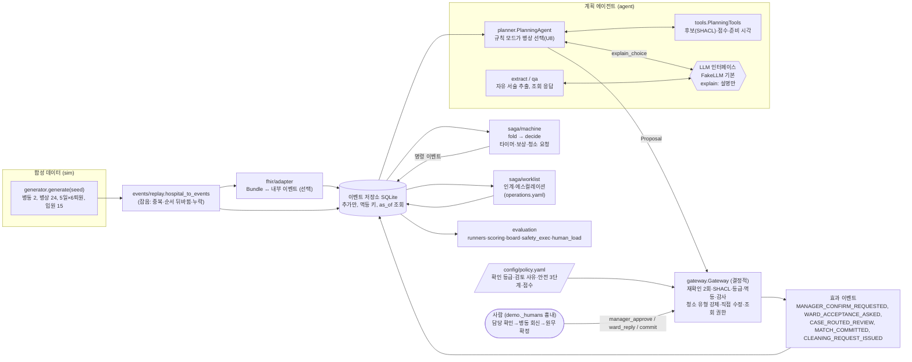
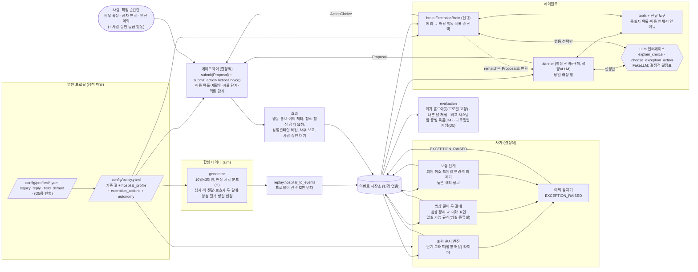

# 아키텍처 개정안: 현장 조사 반영과 예외 판단 머리 (2026-11-09)

- 작성: 소프트웨어 아키텍트 관점(이벤트 소싱, 사가, 에이전트 시스템) 검토안. **승인 전 초안**이다. 코드는 아직 바꾸지 않았다.
- 상위 근거: `CLAUDE.md`, `docs/병상턴어라운드_설계.html`(설계의 정답), `docs/SPEC.md` v1.0, `docs/DECISIONS.md` 2026-11-09 항목 전부(현장 조사 반영 A~H, 청소 두 갈래와 범위, 격리 정보 처리 정정, 선제 격리는 알림으로, 남녀 병실 법령 금지, 기간 10일, U8 확장, 병실 이동 연쇄 표시만, 결핵 60분, 안전 지표 실행 상태), `docs/기획/병상사이클_지도.html`, `docs/검토/차별점/최종_방향안.md`.
- 읽은 코드: `events/models.py`, `events/replay.py`, `saga/machine.py`, `gateway/gateway.py`, `gateway/policy.py`, `agent/planner.py`, `agent/tools.py`, `agent/llm.py`, `sim/models.py`, `sim/generator.py`, `evaluation/runners.py`, `evaluation/runners_gateway.py`, `evaluation/safety_exec.py`, `evaluation/scoring.py`, `evaluation/human_load.py`, `ui/demo.py`, `config/policy.yaml`, `config/operations.yaml`, 회귀·홀드아웃 시나리오 43개.
- 표기: **[사용자 확인 필요 Qn]** 은 사용자 답이 있어야 진행하는 항목이다. 전체 목록은 10절에 모았다. "설계 가정"은 근거를 찾지 못한 값과 절차다(CLAUDE.md 7번).
- 숫자는 모두 합성 데이터 기준 추정이며 병원 발표 수치와 비교하지 않는다.

---

## 0. 한 장 요약

| 원칙 | 내용 |
|---|---|
| 바꾸지 않는 것 | 이벤트 저장소(추가만, 멱등 키, 인지 시각), 사가의 "접어서 계산" 방식, 게이트웨이의 두 번 재확인·SHACL·확인 등급·감사, 병상 선택과 숫자는 결정적 코드(U8), 가짜 LLM 기본값 |
| 새로 넣는 것 | (1) **병원 프로필**(정책 파일의 새 절들): 퇴원 순서, 배정 시점, 병동 확인 방식, 보호자 갈래, 청소 분담과 입실 가능 범위, 격리 알림, 이동 연쇄 표시. (2) **예외 판단 머리**(`agent/brain.py`): 사가가 결정적으로 감지한 예외마다 정해진 행동 목록 중 하나를 LLM이 고르고, 게이트웨이의 새 입구 `submit_action`이 검사·실행한다. (3) 이벤트 38종 추가(퇴원 9, 병상 준비 4, 입원 5, 격리 5, 병실 변경 3, 예외 머리 9, 약속 3. 전부 추가형, 옛 이벤트 의미 유지) |
| 호환 방식 | 모든 새 스위치는 먼저 **옛 동작 값(legacy)으로 들어가** 30/30, 13/13을 그대로 지킨다. 기본값 전환(현장값)은 스위치마다 **한 커밋**으로 따로 하고, 그때 영향받는 시나리오의 개정판을 사용자에게 보인다(DECISIONS B) |
| 순서 | 기반(S0~S1) → D2(늦은 격리 양성, S2~S6) → D1(나쁜 날, S7~S14) → D4(밤 증빙, S15~S16) → D3(약속, S17) → D5(프로필별 재생, S18) |

---

## 1. 구성도

### 1.1 현재 구조 (2026-11-09 코드 기준)



현재 구조의 빈 곳(지도와 대조):
- 사가는 퇴원 단계를 **고정 순서**(퇴원약 준비 → 수납)로 본다. 심사, 간호사 퇴원 연락, 약 전달, 병동 준비, "올려주세요", 입실 사건이 없다.
- 게이트웨이의 확정 조건에 **병동 수용 회신**이 들어 있다(`_check_commit`의 `ward_acceptance_missing`). 현장 기본은 통보형이다(DECISIONS C).
- 에이전트는 **전날 저녁 사전 매칭**을 전제로 언제든 돈다(`PlanningAgent.step`에 시간 창이 없음).
- 예외 때 할 일은 사가와 게이트웨이에 **코드로 박혀** 있고(재매칭 `_rematch`, 사람 작업 생성), 판단 머리가 없다(최종 방향안 3절: "완전 자동 0%").
- 청소는 한 갈래(`CLEANING_*` + `BED_READY`)이고 입실 가능 범위가 병실 종류와 무관하다.

### 1.2 개정 구조



### 1.3 LLM과 프로필이 놓이는 자리

| 자리 | LLM이 하는 일 | LLM이 못 하는 일 | 실패하면 |
|---|---|---|---|
| 계획 에이전트 `explain_choice` (지금 그대로) | 규칙이 고른 병상의 설명 | 병상 선택, 점수 | 규칙 근거 문장 |
| **예외 머리 `choose_exception_action` (신규)** | 예외 하나에 대해 **허용 목록 안의 행동 하나와 매개변수** 선택, 근거 한두 문장 | 목록 밖 행동, 숫자 계산(대안 이득·준비 시각은 도구가 준다), 되돌릴 수 없는 행동 실행, 안전상 필수 행동 생략 | 사람에게 올림(`escalate`, 지금 규칙과 같음) |
| 추출·질의 (지금 그대로) | 자유 서술 → 필드, 질문 해석 | 격리 판단 | 규칙 경로 |

- 프로필은 **정책 파일 한 곳**에 둔다. 사가(`SagaPolicy`)·게이트웨이(`Policy`)·생성기(`GeneratorConfig`)·머리(`ExceptionCatalogue`)가 같은 `HospitalProfile` 객체를 받는다. 지금 `SagaPolicy`의 시각 값(19:00, 11:00, 120분 등)은 프로필에서 만들어지게 바꾼다(기본값은 지금 값과 같게 시작).
- 2단계 온보딩 에이전트가 나중에 만들 대상이 바로 이 프로필이다(G5). 그래서 프로필은 "병원이 고르는 값"만 담고, 지침·법령 잠금 값(결핵 60분, 남녀 구별, 되돌릴 수 없는 행동의 사람 등급)은 코드 상수로 잠근다(`LOCKED_SAFETY_TIERS`와 같은 방식).

---

## 2. 이벤트 모델 변경

### 2.1 원칙
1. **추가만 한다.** 옛 이벤트 타입의 이름·의미·멱등 키 형식을 바꾸지 않는다. 예: `WARD_NOTIFIED`는 지금처럼 "수용 회신 철회 통지"로 남기고, 배정 통보는 새 타입으로 둔다(채점의 `notify_ward` 라벨이 철회 통지를 뜻하므로).
2. `Event` 모델(`extra="forbid"`)은 그대로 두고, 새 타입의 payload만 `events/payloads.py`의 pydantic 모델로 **새 타입에 한해** 검사한다(옛 타입은 검사하지 않아 옛 고정 데이터가 깨지지 않는다).
3. 사가 `fold`는 모르는 타입을 무시한다(지금도 그렇다). 프로필이 켜지 않은 신호는 생성기·재생이 내지 않는다.
4. 신호가 **없는 원천**을 고려한다: 단계 이벤트가 한 번도 오지 않는 병원(예: 심사 완료를 HIS가 안 내는 병원)은 프로필의 `his_signals`에서 끄고, 사가는 그 단계를 건너뛰고 옛 기준점으로 대신한다(지금 `DISCHARGE_RX_ISSUED or ORDER_CONFIRMED` 대체와 같은 방식).
5. FHIR 어댑터(`fhir/adapter.py`)에 새 타입 매핑을 같은 커밋에 넣는다. 시드 200개 동등성 테스트가 이것을 잡는다.

### 2.2 새 이벤트 타입

source 표기: his(병원 시스템), human(사람 입력), saga, agent, gateway.

**퇴원 줄 (지도 2~7)**

| 타입 (값) | source | payload (필수 / 선택) | 비고 |
|---|---|---|---|
| `BILLING_REVIEW_REQUESTED` (`billing_review_requested`) | his/human | bed_id / requested_by(ward) | 처방 마감 뒤 심사 요청. 전북대 "09시까지 심사 요청" 근거. 없는 병원은 끔 |
| `BILLING_REVIEW_DONE` (`billing_review_done`) | his | bed_id / reviewer_dept(원무, 보험심사, 심사평가), estimated_amount_ready: bool | 심사 완료. 수납·연락의 기준점 |
| `BILLING_REVIEW_REOPENED` (`billing_review_reopened`) | his | reason(rx_revised, order_added, other) | "심사 풀고 다시 심사". 처방 수정 뒤 심사 완료가 다시 필요 |
| `DISCHARGE_NOTICE_GIVEN` (`discharge_notice_given`) | human | channel(phone, sms, in_person) / by_role(ward_nurse) | 간호사가 환자에게 심사 완료·수납 안내(지도 4). 입원 측 `PATIENT_CONTACTED`와 다른 사건 |
| `RECEIPT_CHECKED` (`receipt_checked`) | human | / method(paper, mobile) | 간호사실 영수증(퇴원수속완료증) 확인. 없는 병원은 끔 |
| `MEDICATION_HANDED_OVER` (`medication_handed_over`) | human | / with_education: bool | 퇴원약 전달(지도 6, "준비와 전달 분리"). `MEDICATION_READY`(병동 도착)와 다르다 |
| `GUARDIAN_DELAY_REPORTED` (`guardian_delay_reported`) | human | kind(same_day, date_change), eta(iso, same_day일 때) / new_date | 보호자 지연 두 갈래의 원 신호. same_day는 기존 `GUARDIAN_ETA_UPDATED`와 같이 처리, date_change는 2.4의 보류 경로로 |
| `LOUNGE_OFFERED` (`lounge_offered`) / `LOUNGE_ACCEPTED` (`lounge_accepted`) | agent→gateway / human | location / reason | 퇴원 라운지 제안과 수락. 수락 뒤 퇴실은 `PATIENT_DEPARTED{destination: lounge}` |

기존 `PATIENT_DEPARTED` payload에 `destination: home | lounge | transfer`(기본 home)를 더한다(선택 필드라 옛 데이터 그대로 유효).

**병상 준비 (지도 8~11, 청소 두 갈래)**

| 타입 | source | payload | 비고 |
|---|---|---|---|
| `BED_PREP_REQUESTED` (`bed_prep_requested`) | saga/gateway | bed_id, mode(on_departure, batch, expedite) / batch_at, needed_by | 침상 정리(리넨·커튼·침대·매트리스·의료기구 정리·신환 침상 준비) 요청. **사람 지정은 하지 않는다**(CLAUDE.md 4번) |
| `BED_PREP_DONE` (`bed_prep_done`) | human | bed_id / by_role(nursing_aide, ward_assistant) | 침상 정리 완료 |
| `CLEANING_INSPECTED` (`cleaning_inspected`) | human | bed_id, result(pass, fail) / method(ATP, visual) | 격리 종말소독 청결도 확인. 불합격이면 재청소. 프로필 옵션(기본 끔) |
| (새 타입 없음) 종말소독 상향 | saga | 기존 `CLEANING_REQUEST_ISSUED`를 키 `cleaning_request:terminal_upgrade`, `cleaning_type: terminal`, `reason: isolation_after_departure`로 한 번 더 냄 | 작업 트리에 진행 중인 사가 변경(2026-11-09, `machine.py` 미커밋)이 이 방식이다. 새 타입 `CLEANING_REQUEST_UPGRADED`를 따로 만들지 않고 이 방식을 따른다(채점의 `send_cleaning_request{terminal}` 라벨과도 맞음) |
| `BED_VACANCY_REVOKED` (`bed_vacancy_revoked`) | saga | bed_id, reason(late_isolation) | 이미 낸 입실 가능(`BED_MARKED_VACANT`)을 되돌림 |

기존 `CLEANING_REQUEST_ISSUED`·`CLEANING_STARTED`·`CLEANING_DONE`은 **미화(표면·종말소독) 갈래**로 의미를 좁히고, payload에 `scope: bed_unit | room | room_terminal`(선택, 없으면 옛 의미 = 병실 전체)을 더한다. 기존 `BED_READY`는 legacy 프로필에서 "준비 완료(두 갈래 합친 신호)"로 계속 받는다. field 프로필의 재생은 `BED_READY` 대신 `BED_PREP_DONE`을 낸다(3.5).

**입원 줄 (지도 B~F, 만나는 곳 1~3)**

| 타입 | source | payload | 비고 |
|---|---|---|---|
| `WARD_ASSIGNMENT_NOTIFIED` (`ward_assignment_notified`) | gateway | bed_id, proposal_id / objection_until | 통보형: 원무 확정 뒤 병동 통보(지도 D). 회신형은 기존 `WARD_ACCEPTANCE_ASKED` |
| `WARD_OBJECTION_RAISED` (`ward_objection_raised`) | human | proposal_id, reason(code) / detail_code | 통보형의 병동 이의 제기. 보상 경로(3.7) |
| `WARD_PREP_DONE` (`ward_prep_done`) | human | admission_id, bed_id / items(order_check, med_ticket, name_card, bed) | 병동 준비 완료(지도 E). 만나는 곳 1 |
| `PATIENT_CALL_UP` (`patient_call_up`) | human | admission_id, bed_id / by_role(ward) | "올려주세요"(만나는 곳 2). 배정 확정과 다른 사건 |
| `PATIENT_ARRIVED` (`patient_arrived`) | his/human | admission_id, bed_id | 입실(만나는 곳 3). 이 뒤로 입원 사례는 재원 환자가 된다 |

`PATIENT_CALL_UP`은 병동이 내는 **신호 한 건**으로만 받는다. 이송 상태 추적과 입실 안내 자동 발송은 설계 문서에서 "설계"이므로 만들지 않는다(CLAUDE.md 5번). **[사용자 확인 필요 Q12]**

**격리 정보 (DECISIONS "격리 정보 처리 정정", "선제 격리는 알림으로")**

| 타입 | source | payload | 비고 |
|---|---|---|---|
| `SCREENING_ORDERED` (`screening_ordered`) | his | panel(CRE, VRE, MRSA, ...) / specimen_at | 입원 선별검사 시행. 결과 대기 자체로는 아무것도 막지 않는다 |
| `SCREENING_RESULT_REPORTED` (`screening_result_reported`) | his | organism, result(positive, negative) / specimen_at, reported_at | 결과 보고. 양성만으로 격리 규칙을 적용하지 않는다(오더로만) |
| `ISOLATION_RISK_ALERTED` (`isolation_risk_alerted`) | saga | basis(list: mdro_history:VRE, recent_other_hospital, overseas_hospital, icu_transfer), screening_pending: bool, to(list: bed_manager, ipc) | 고위험 조건·과거력 알림. **격리 여부와 병실은 사람이 정한다** |
| `ISOLATION_REGISTRATION_MISMATCH` (`isolation_registration_mismatch`) | saga | organism, result_seq | 양성 결과는 있는데 격리 오더·표시가 없음(QIH 2022 등록률 53% 사례) → 감염관리실 작업 |
| `CONTACT_TRACE_REQUESTED` (`contact_trace_requested`) | gateway | index_case, room_id, contacts(list of case_id/bed_id), window(from, to) | 같은 병실 접촉자 관리 요청을 감염관리실에 올림(D2). 이름은 넣지 않는다 |

기존 `ADMISSION_REQUESTED` payload 선택 필드: `mdro_history: [..]`, `recent_other_hospital_stay: bool`, `overseas_hospital_stay: bool`, `preferred_grade: multi | double | single | special`, `admission_route: scheduled | icu_stepdown | ed`(ed는 설문 뒤), `planned_window: am | pm`.

**병실 변경 (DECISIONS "병실 이동 연쇄 표시만")**

| 타입 | source | payload | 비고 |
|---|---|---|---|
| `ROOM_CHANGE_REQUESTED` (`room_change_requested`) | his/human | patient_case, current_bed, wish_grade / wish_room_type, reason(fee, preference, clinical), fee_consent | 재원 환자 병실 변경 신청 |
| `ROOM_CHANGE_WITHDRAWN` (`room_change_withdrawn`) | human | patient_case | 신청 철회 |
| `ROOM_CHANGE_COMPLETED` (`room_change_completed`) | his/human | patient_case, from_bed, to_bed | 사람이 한 이동. 점유가 바뀌므로 게이트웨이 `_occupants`가 반영 |

**예외 판단 머리 (4절)**

| 타입 | source | payload |
|---|---|---|
| `EXCEPTION_RAISED` (`exception_raised`) | saga | exception_id, trigger, case, related(list), deadline, basis_seq |
| `EXCEPTION_RESOLVED` (`exception_resolved`) | saga/gateway | exception_id, how(action, superseded, expired, human) |
| `ACTION_PROPOSED` (`action_proposed`) | agent | exception_id, action, params, rationale, mode(llm, fake, fallback), model, basis_seq |
| `ACTION_EXECUTED` (`action_executed`) / `ACTION_REJECTED` (`action_rejected`) | gateway | exception_id, action, reasons, autonomy |
| `ACTION_APPROVAL_REQUESTED` (`action_approval_requested`) / `ACTION_APPROVED` (`action_approved`) | gateway / human | exception_id, action, approver_role |
| `ACTION_REPORTED` (`action_reported`) | gateway | exception_id, action, to_role (사후 보고 등급) |
| `RECHECK_SCHEDULED` (`recheck_scheduled`) | gateway | exception_id, at (`wait` 행동의 다시 보기 타이머) |

**약속 (D3)**: `PROMISE_MADE` (`promise_made`, payload: to_role 또는 to=patient_family, what=ready_by|call_by, due, basis_seq) / `PROMISE_KEPT` / `PROMISE_AT_RISK`(saga). `QUERY_ANSWERED`에 예상 시각이 들어가면 게이트웨이가 `PROMISE_MADE`를 같이 남긴다.

### 2.3 기존 시나리오·고정 데이터 호환
- 옛 고정 데이터(`runners*.py`의 `_ev` 묶음, 생성기 시드)는 새 타입을 하나도 내지 않는다. 사가가 새 단계를 "신호 없음"으로 건너뛰므로 같은 명령 이벤트가 나온다. 이것을 **C01 사가 서명 테스트**(`_saga_signature`)로 S1에서 확인한다.
- 사가 명령의 멱등 키(`{case}:saga:recompute:medication_delay`, `share:billing`, `cleaning_request`, `bed_vacant` 등)는 legacy 순서 프리셋에서 **글자 하나 바꾸지 않는다.** 새 단계 키는 새 이름(`recompute:{step}_delay`)만 쓴다.
- `scoring.ACTION_BY_EVENT`와 `scenario.py`의 행동 이름 목록에 새 행동(`notify_ward_assignment`, `request_bed_prep`, `revoke_vacancy`, `request_contact_trace`, `alert_isolation_risk`, `raise_exception`, `execute_action`, `request_action_approval`)을 **추가만** 한다. 기존 이름의 대응은 그대로다.

### 2.4 퇴원일 변경은 기존 회차 경로로
보호자 사정 등으로 퇴원일이 바뀌는 경우는 새 상태를 만들지 않고 **지금의 회차 경로**(EVT-5: `DISCHARGE_CANCELLED` → 새 회차 `DISCHARGE_DECIDED{round: n+1}`)로 받는다. `DISCHARGE_CANCELLED.payload.reason = date_change`와 `new_date`를 더해, 보상은 지금 그대로(연락 전 자동 해제, 연락 후 담당 검토와 재연락) 돌고, 지표·증빙에서는 "취소"가 아니라 "퇴원일 변경(보호자)"으로 센다. HIS가 날짜만 바꿔 보내는 원천(`GUARDIAN_DELAY_REPORTED{kind: date_change}`)은 재생 계층에서 이 두 이벤트로 바꿔 넣는다. 이유: 사가 코드 변경이 가장 작고, 보상 단계가 이미 회귀 시나리오 C02·C03으로 검증돼 있다. 이 선택은 구현 전에 DECISIONS에 적는다.

---

## 3. 사가 변경

### 3.1 퇴원 순서 엔진 (DECISIONS D)
지금 `_decide_discharge`의 타이머 묶음(퇴원약 지연, 처방 없음, 수납 대기)을 **단계 그래프**를 읽어 도는 일반 루프로 바꾼다. 그래프는 프로필의 데이터다.

```yaml
discharge_sequence:
  preset: field                # field | legacy
  steps:                       # id: 완료 이벤트, 선행 단계(모두 끝나야 시작), 시작 뒤 기한, 지연 사유 코드, 담당 역할
    rx:        {done: [discharge_rx_issued], after: [], due_at: "09:00", delay_code: rx_missing, owner: ward}
    review:    {done: [billing_review_done], after: [rx], within_min: 60, delay_code: billing_review, owner: billing_review}
    dispense:  {done: [medication_ready], after: [rx], within_min: 120, delay_code: medication, owner: pharmacy}
    notice:    {done: [discharge_notice_given], after: [review], within_min: 20, delay_code: notice, owner: ward}
    payment:   {done: [billing_done], after: [notice], within_min: 60, delay_code: billing, owner: admission_office}
    receipt:   {done: [receipt_checked], after: [payment], within_min: 15, delay_code: receipt, owner: ward, optional: true}
    handover:  {done: [medication_handed_over, education_done], after: [receipt, dispense], within_min: 20, delay_code: handover, owner: ward}
    departure: {done: [patient_departed], after: [handover], due_at: "11:00", delay_code: departure, owner: ward}
```

- 규칙(결정적): 선행 단계가 모두 끝난 시각 + `within_min`(또는 `due_at`)까지 완료 이벤트를 인지하지 못하면 `READY_TIME_RECOMPUTED{reason: <step>_delay}`와 `DELAY_REASON_RECORDED{reason: delay_code}`를 낸다. 다음 환자가 이 병상을 기다리면 담당 역할 화면에 `SHARE_WAITING_INFO`(자동). "기한 시각까지 인지한 사실로 판정"하는 지금 원칙(`by()`)을 그대로 쓴다.
- `BILLING_REVIEW_REOPENED`가 오면 review 이후 단계의 완료를 지우고 다시 센다(회차와 같은 방식으로 `scope` 접두사 `rv{n}`).
- `optional: true` 단계는 신호가 한 번도 안 오는 원천에서는 그래프에서 빠진다(2.1의 4).
- **legacy 프리셋**은 지금 코드의 세 타이머를 같은 키로 재현한다(`medication_delay` 기준점 = 처방 발행, `rx_missing` 11:00, `billing_wait` = 퇴원약 도착 + 60분). 회귀 30개는 S0~S8 동안 이 프리셋으로 돈다.
- field 프리셋에서 수납 대기 기준점은 **심사 완료(또는 간호사 연락)** 다. E04가 바뀌는 이유다(7절).
- 처방 없음 알림 시각 기본값: 지금 11:00. 현장 근거(전북대 09:00 심사 요청, 지도 2 "11시 알림은 현장 기준보다 늦음")로는 09:00이 맞다. **[사용자 확인 필요 Q4]**
- `tools.ready_at`의 퇴실 예상은 고정 `DEFAULT_DEPARTURE 11:00 + exit_prep` 대신 같은 그래프의 "남은 단계 중앙값 합"으로 계산한다(결정적, 단계 분포는 생성기와 같은 `distributions.py`). 몬테카를로 추정(`forecast/noon.py`)도 같은 그래프를 쓴다.

### 3.2 보호자 지연 두 갈래와 라운지 (DECISIONS E)
- **당일 지연**: `GUARDIAN_ETA_UPDATED`(지금 그대로) 또는 `GUARDIAN_DELAY_REPORTED{same_day}`. 준비 시각 재계산과 지연 사유 기록은 지금 코드 그대로. 새로 더하는 것: 예상 퇴실이 `departure.due_at + guardian.same_day_tolerance_min`을 넘고 이 병상을 기다리는 매칭이 있으면 `EXCEPTION_RAISED{trigger: guardian_delay_same_day}`(행동 선택은 4절: 기다림, 라운지 제안, 재매칭, 원무에 시각 공유).
- **퇴원일 변경**: 2.4대로 회차 경로. 예외 `discharge_date_changed`는 보상(필수, 결정적) 뒤 남은 선택(지금 재매칭할지, 다른 병상 준비를 기다릴지, 올릴지)만 머리에 넘긴다.
- **라운지**: 프로필 `guardian.lounge.enabled`. 라운지 수락(`LOUNGE_ACCEPTED`) 뒤 `PATIENT_DEPARTED{destination: lounge}`로 병상이 먼저 빈다. 수납·약 전달 단계는 퇴실 뒤에도 이어서 추적하되(증빙용) 병상 준비 시각 계산에는 넣지 않는다. 격리 환자, 이동 보조가 필요한 환자(`mobility_aid` 추출 필드)는 제안 대상에서 뺀다(설계 가정). **[사용자 확인 필요 Q9]**

### 3.3 청소 두 갈래와 입실 가능 규칙 (DECISIONS "청소", "입실 가능 기준의 청소 범위")
퇴실을 인지하면 사가가 두 요청을 동시에 낸다.
1. `BED_PREP_REQUESTED` (병원 직원 갈래): `bed_prep.mode`가 `on_departure`면 즉시, `batch`면 다음 일괄 시각(기본 후보 13:30, 해운대백 과업지시서)으로. 다음 환자 필요 시각이 일괄 시각보다 이르면 예외 `bed_prep_expedite`(머리가 "먼저 해 달라" 요청을 고름, 자동 등급).
2. `CLEANING_REQUEST_ISSUED` (미화 갈래, `housekeeping.enabled`일 때): `scope`는 병실 종류로 정한다. 격리 퇴실은 지금처럼 종말소독 강제·환기 대기(결핵 60분 하한 포함)·아포 소독.

입실 가능(`BED_MARKED_VACANT`) 판정은 **결정적 규칙 표**다.

| 퇴실 병상 | 필요한 완료 신호 | 범위 근거 |
|---|---|---|
| 격리 퇴실(병실 종류 무관) | 종말소독 `CLEANING_DONE{scope: room_terminal}`(+ `CLEANING_INSPECTED pass`, 옵션) **그리고** `BED_PREP_DONE`, 환기 대기 경과 | 지침(종말소독), DECISIONS |
| 1인실 | `BED_PREP_DONE` **그리고** (미화 켬이면) `CLEANING_DONE{scope: room}` — 화장실 포함 병실 전체 | DECISIONS(설계 가정 아님: 사용자 지적) |
| 다인실 | `BED_PREP_DONE` **그리고** (미화 켬이면) `CLEANING_DONE{scope: bed_unit}` — 침대·매트리스·침상 주변 표면·리넨·커튼. 공용 화장실·바닥은 정기 청소 | 설계 가정, 현직자 확인 대상 |
| legacy 프로필 | 지금 규칙(`BED_READY`, 격리면 `CLEANING_DONE`도) | 회귀 30개 보호 |

- 미화를 끈 병원은 "병원 직원 갈래만" 본다. 격리 종말소독은 미화가 꺼져도 **누군가의 `CLEANING_DONE{room_terminal}`이 반드시 필요**하다(잠금).
- 청소 지연 타이머는 갈래마다 따로 둔다(`cleaning_overdue`는 미화 갈래, `bed_prep_overdue`는 직원 갈래). 둘 다 예외 `cleaning_overdue`로 머리에 간다.
- 다인실 침상 단위 표면을 미화가 하는지 병원 직원이 하는지는 병원마다 다를 수 있다. **[사용자 확인 필요 Q5]**
- 실행 상태 안전 S2(`safety_exec._s2`)는 위 표를 그대로 검사하도록 고친다: "빈 병상 전환과 확정이 규칙 표의 신호보다 앞서지 않았는가".

### 3.4 배정 시점: 당일 오전 기본 (DECISIONS B)
- 사가에는 큰 변경이 없다(사전 매칭 이벤트는 누가 언제 내든 같은 방식으로 접는다). 바뀌는 곳은 **계획 에이전트의 시간 창**이다: `assignment.timing: same_day_morning`이면 정규 입원(`admission_route: scheduled`)은 입원일의 `assignment.window`(기본 후보 08:00~11:30) 안에서만 후보를 찾는다. 중환자실 하향 등 비정규 경로는 창 밖에서도 찾는다. **[사용자 확인 필요 Q13]**
- 당일 배정이어도 "퇴원 예정 병상(아직 퇴실 전)에 매칭"은 그대로 있다(11시 퇴실, 14시 입실). 그래서 `PREMATCH_CREATED`와 보상 경로, `discharge_id` 연결은 그대로 쓴다. 이름 "사전 매칭"은 화면에서 "퇴실 전 배정"으로 바꾼다.
- `prematch_evening` 옵션은 지금 동작(전날에도 돈다)이다. 전날 19:00 청소 예정표 공유와 미등록 확인은 배정 시점과 무관하게 남는다.
- 환자 연락 목표 시각(`assignment.contact_by`, 공개 안내 11:00~11:30)을 프로필에 두고, 연락이 이 시각을 넘길 위험이면 예외 `contact_deadline_at_risk`(D3와 연결).

### 3.5 병동 확인 방식: 통보형 기본, 회신형 옵션 (DECISIONS C)
게이트웨이 변경이 중심이고, 사가는 보상만 넓힌다.

| | 통보형 `notify` (기본) | 회신형 `reply` (옵션, 지금 동작) |
|---|---|---|
| 담당 확인 등급 경로 | 제안 → (1단계) 원무 배정 담당 확인·확정 → `WARD_ASSIGNMENT_NOTIFIED` | 제안 → 담당 확인 → `WARD_ACCEPTANCE_ASKED` → 수용 회신 → 원무 확정 |
| 확정 조건 | 수용 회신 **불필요**. 그 밖의 확정 직전 검사(재확인, 동시 확정, 종말소독 선행, FHIR 버전, SHACL)는 같다 | 지금 그대로(`ward_acceptance_missing`) |
| 병동의 반대 | `WARD_OBJECTION_RAISED`(이의 기간 `objection_window_min` 안팎 모두 받음) | `WARD_REJECTED` |
| 철회 통지(`WARD_NOTIFIED`) | 배정 통보를 받은 매칭을 해제하면 보낸다 | 수용 회신을 받은 매칭을 해제하면 보낸다(지금) |

- 사가 `_notify_ward_if_accepted`의 조건을 "수용 회신 **또는** 배정 통보를 받은 매칭"으로 넓힌다. 회신형에서는 결과가 같다.
- 이의 제기 보상: 환자 연락 전이면 자동 해제·재매칭(재매칭은 머리가 고를 수 있는 행동), 연락 후면 담당 검토와 재연락 사람 작업(SAG-4와 같은 원칙).
- 통보형 1단계에서 "담당 확인"과 "원무 확정"을 한 사람의 한 동작으로 합칠지 정해야 한다. 공개 자료에서 배정과 확정은 같은 원무 배정 담당이 한다(서울성모 입퇴원Unit "입원수속·병실배정"). 합치면 일반 사례의 사람 개입이 3회(확인, 회신, 확정)에서 1회(확정)로 준다. **[사용자 확인 필요 Q1]**

### 3.6 만나는 곳 1~3: 병동 준비, "올려주세요", 입실
- 사가가 입원 사례마다 세 사실을 접는다: 입실 가능(병상), `WARD_PREP_DONE`(병동), `MATCH_COMMITTED`(원무).
- 셋이 모두 맞으면 "올릴 수 있음" 상태를 화면에 띄운다(자동 공유). 병상은 준비됐는데 병동 준비가 기준 시간 넘게 없으면 예외 `call_up_stalled`(머리: 병동에 상기, 원무에 예상 시각 공유, 올림). 보호자가 먼저 올라가 "자리가 비었는데"가 생기는 지점을 겨냥한다.
- 게이트웨이는 `PATIENT_CALL_UP` 이벤트를 받을 때 입실 가능·확정이 없으면 **경보만** 낸다(병동의 실제 행동을 막지 않는다. 기록 계층이므로).
- `PATIENT_ARRIVED` 뒤 입원 사례는 재원 환자로 넘어간다. 게이트웨이 `_occupants`와 재확인 범위(GW-9)가 이 사례를 재원 환자로 본다.

### 3.7 늦게 온 격리 양성 결과의 보상 흐름 (D2, G2)
양성 결과(`SCREENING_RESULT_REPORTED positive`)는 **격리 오더가 아니다.** 격리 규칙은 사람(주치의·감염관리실)의 `ISOLATION_ORDER_ADDED` 뒤에만 적용한다. 사가가 결정적으로 하는 일은 아래 표다. "선택"이라고 적은 칸만 예외 머리로 간다.

**(가) 양성 결과가 왔는데 격리 오더가 아직 없음**
- `isolation.mismatch_alert_min`(기본 후보 60분, 설계 가정) 안에 오더가 없으면 `ISOLATION_REGISTRATION_MISMATCH` + 감염관리실 작업.
- 이 환자에게 결론 전 제안·확정 대기가 있으면 게이트웨이는 양성 결과를 **판단 정보 변경**으로 보고 확정을 멈춘다(`_MATERIAL`에 추가). 격리를 결정하는 것이 아니라 "오더 판단 전까지 확정 보류"다. **[사용자 확인 필요 Q7]**

**(나) 격리 오더가 늦게 들어옴: 입원 측 사례 상태별**

| 입원 사례 상태 | 필수(결정적, 자동) | 선택(머리) | 사람 |
|---|---|---|---|
| 제안만 있음, 결론 전 | 게이트웨이가 다음 단계에서 `info_changed`로 거부(지금 B01) | 재제안 시점(즉시 / 감염관리실 판단 대기) | - |
| 퇴실 전 배정, 연락 전 | 매칭 해제(`PREMATCH_RELEASED{reason: isolation_order_added}`), 배정 통보를 받았으면 철회 통지 | 즉시 재매칭(격리 가능 병상) / 기다림 / 담당에게 올림 | - |
| 연락 후, 입실 전 | 담당 검토 재분류, 재연락 작업 | 감염관리실에 먼저 올릴지 여부 | 원무 재연락, 확정 철회는 사람(책임 순간) |
| 입실 뒤(다인실) | 동실자 목록 계산(도구) → `CONTACT_TRACE_REQUESTED`(감염관리실), 격리 병상 후보 계산, 그 병실 신규 배정에 경보 | 감시 대기(`surveillance_hold`) 제안 여부, 올릴 대상 순서 | 감염관리실이 접촉자 관리·감시 대기를 결정, 이동은 사람 |

**(다) 격리 정보가 퇴실 뒤 도착: 병상 측**

| 그 병상 상태 | 필수(결정적, 자동, 조이는 방향) |
|---|---|
| 일반 청소 요청됨·진행 중 | 종말소독 상향 요청(`CLEANING_REQUEST_ISSUED{terminal, reason: isolation_after_departure}`, 환기 대기, 아포). 빈 병상 전환은 상향 요청 **뒤의** 완료 신호로만 |
| 일반 청소 완료, 입실 가능 표시 | `BED_VACANCY_REVOKED` + 종말소독 요청 |
| 다음 환자 확정, 입실 전 | 위 둘 + 그 확정은 확정 직전 검사에서 막힘(종말소독 선행). 연락 전이면 해제·재매칭, 연락 후면 담당 검토·재연락 |
| 다음 환자 이미 입실 | 접촉자 관리 요청(위 (나)의 마지막 줄과 같음) |

- 이 흐름은 "되돌릴 수 있는 것은 자동으로 되돌리고, 되돌릴 수 없는 것(환자 연락, 공식 확정)은 사람에게"라는 지금 원칙(목표 함수 2항, SAG-4)을 그대로 넓힌 것이다.
- 고위험 조건 알림(`ISOLATION_RISK_ALERTED`)은 입원 요청을 인지할 때 한 번 낸다. 막지 않고, 확인 등급도 바꾸지 않는다. 고위험 조건 목록은 병원 설정이다.

### 3.8 사가 내부 구조 변경 (최소)
- `DischargeCase`에 `sequence_done: dict[str, datetime]`, `bed_prep`, `destination`, `date_change` 정도만 더한다. `stage` 속성은 지금 순서표에 새 사실을 끼워 넣는다(옛 사실만 있으면 결과가 같다).
- 입원 측 상태를 지금 `MatchCase` 하나에서 `AdmissionCase`(매칭 + 통보·이의 + 병동 준비 + 올려주세요 + 입실 + 격리 알림)로 넓힌다. `MatchCase`는 그대로 두고 `AdmissionCase.match`로 감싼다(호출부 변경 최소).
- 새 `decide_*` 함수는 파일을 나눈다: `saga/sequence.py`(퇴원 순서), `saga/bedprep.py`(두 갈래·입실 가능 규칙), `saga/isolation.py`(3.7), `saga/exceptions.py`(예외 감지와 `EXCEPTION_RAISED`). `machine.py`는 접기와 조립만 남긴다.

---

## 4. 예외 판단 머리 (U8 확장)

### 4.1 경계
- **감지는 사가(결정적)**, **선택은 LLM**, **검사·실행은 게이트웨이(결정적)**. 머리는 상태를 갖지 않는다(매 주기 저장소에서 열린 예외를 읽는다). 재시작해도 같은 예외를 같은 멱등 키로 다시 본다.
- 안전에 필요한 행동(청소 유형 올림, 입실 가능 되돌림, 연락 전 매칭 해제 등)은 **필수 행동**으로 사가가 먼저 낸다. 머리는 필수 행동을 생략하거나 되돌릴 수 없다.
- 되돌릴 수 없는 행동(환자 연락, 공식 확정, 안전 예외 승인)은 목록에 **없다.** 머리는 그 행동을 "사람에게 요청"(`escalate`, `request_recontact`)으로만 고를 수 있다.
- 설계 문서의 "공정별 도메인 에이전트와 조정 에이전트"(설계 항목)는 만들지 않는다. 머리는 계획 에이전트 안의 한 구성 요소다.

### 4.2 예외 목록 (트리거 → 허용 행동)
`config/policy.yaml`의 `exception_actions`에 데이터로 둔다. 1차 구현은 E1만, S13에서 나머지.

| ID | 트리거(사가가 감지) | 필수 행동(결정적) | 허용 행동(머리가 하나 선택) | 결정적 대체 |
|---|---|---|---|---|
| E1 `late_isolation` | 매칭·입실한 환자 또는 퇴실 병상에 늦은 격리 오더/양성 결과 | 3.7 표의 필수 칸 | `rematch_now`, `wait_for_ipc`(기한 있음), `escalate(bed_manager \| ipc)`, `propose_surveillance_hold`, `request_contact_trace` | `escalate(bed_manager)` |
| E2 `cleaning_overdue` | 미화·직원 갈래 지연 | 준비 시각 재계산 | `re_request_cleaning`, `request_bed_prep_first`, `rematch_now`, `wait`, `escalate(environment_lead \| ward)` | `escalate` |
| E3 `guardian_delay_same_day` | 예상 퇴실 > 기한 + 허용, 기다리는 매칭 있음 | 재계산, 지연 사유 | `wait`, `offer_lounge`, `rematch_now`, `share_eta(admission_office)` | `wait` 아님 → `escalate` |
| E4 `discharge_date_changed` | 회차 경로의 날짜 변경 | 보상(연락 전 해제 등) | `rematch_now`, `wait_for_bed(id)`, `escalate` | `escalate` |
| E5 `no_bed` | 병상 없음 보고 | 담당 검토 등록(지금) | `wait_for_next_ready`(가장 이른 준비 병상까지), `escalate`, `request_postpone_contact`(원무에게 연기 안내 요청) | `escalate` |
| E6 `info_changed_pending` | 확정 대기 중 판단 정보 변경(B01 유형) | 확정 거부·재분류(지금) | `replan_now`, `escalate` | `escalate` |
| E7 `ward_objection` | 통보형 이의 제기 | 연락 전 해제 / 연락 후 검토 | `rematch_now`, `escalate` | `escalate` |
| E8 `promise_at_risk` | 기록된 약속(D3)·연락 목표 시각이 위험 | - | `request_bed_prep_first`, `re_request_cleaning`, `request_recontact`(사람), `wait` | `request_recontact` |
| E9 `call_up_stalled` | 입실 가능인데 병동 준비 없음 | 공유 | `remind_ward`, `share_eta(admission_office)`, `escalate(ward)` | `remind_ward` 아님 → `escalate` |
| E10 `sequence_stalled` | 퇴원 순서 단계 지연(심사 재오픈 포함) | 재계산, 지연 사유, 대기 정보 공유 | `remind_owner(step.owner)`, `escalate(step.owner)`, `wait` | `escalate` |

결정적 대체는 DECISIONS U8 확장의 "LLM이 실패하면 지금 규칙(사람에게 올림)"이다. 지금 코드가 이미 자동으로 하는 일(예: 청소 지연 재매칭 `_rematch`, 수납 대기 공유)은 대체 경로에서도 지금처럼 유지해 회귀가 바뀌지 않게 한다(4.7).

### 4.3 행동 스키마

```python
class ActionChoice(BaseModel):            # agent/brain.py
    model_config = ConfigDict(frozen=True, extra="forbid")
    exception_id: str                      # EXCEPTION_RAISED.exception_id
    action: str                            # 목록의 행동 ID
    params: dict[str, Any] = {}            # 행동별 스키마로 다시 검증
    rationale: str = Field(max_length=300) # 판단 근거로 쓰지 않는다(감사·화면용)
    basis_seq: int                         # 판단에 쓴 마지막 이벤트 순번 (재확인 1)
    mode: Literal["llm", "fake", "fallback"]

ACTION_PARAMS = {                          # 행동별 매개변수 (전부 결정적으로 검사 가능한 값만)
    "wait": {"until": "datetime <= exception.deadline, <= now + max_wait_min"},
    "wait_for_bed": {"bed_id": "도구가 낸 후보 중 하나"},
    "escalate": {"role": "operations.yaml roles 중, 행동별 허용 목록 안"},
    "rematch_now": {},                     # 병상은 규칙 모드가 고른다 (U8 유지)
    "offer_lounge": {},                    # 장소는 프로필
    "remind_owner": {"step": "현재 지연 단계"},
    "request_contact_trace": {},           # 동실자 목록은 도구가 계산
    ...
}
```

### 4.4 LLM이 고르는 방법
- 작업 이름 `choose_exception_action`(`LLM.complete_json`의 새 task). 입력은 **구조화 JSON만**(SEC-3: 이름·등록번호·자유 서술 원문 없음, 외부 전송 필터 통과).
- 입력 구성:
  - `exception`: trigger, 경과 분, 기한까지 남은 분, 시도 횟수
  - `case_state`: 단계(문자열 코드), 연락 여부, 확정 여부, 격리 오더·결과 상태 코드, 기다리는 입원 사례 수
  - `tool_outputs`(결정적 도구가 계산): 재매칭 최선 후보의 점수 이득과 준비 분, 현재 병상의 준비 P50·P90(`forecast`), 동실자 수, 라운지 가능 여부, 약속 기한
  - `allowed_actions`: `[{id, params_schema, autonomy, note}]` — 정책상 이번 상황에서 가능한 것만(게이트웨이가 미리 거른 목록)
  - `objective`: 목표 함수 1~6항 문장(SPEC 3절)
- 출력: `{"action": "...", "params": {...}, "rationale": "..."}` 한 개. pydantic 검증 실패, 목록 밖, 매개변수 범위 밖이면 대체 경로.
- 시스템 프롬프트 요지: "너는 예외 하나에 대해 허용 목록 중 행동 하나를 고른다. 숫자는 도구 값을 쓰고 지어내지 않는다. 되돌릴 수 없는 일은 사람에게 요청한다. 목표 우선순위 1 안전 2 되돌릴 수 없는 일 최소 ... 6 변동 최소."
- 같은 예외에 같은 입력이면 같은 출력이 필요하다(설계 문서 "같은 입력에 같은 판단"). 실제 모델은 온도를 못 고정하는 계열이 있으므로(DECISIONS: Claude 5 계열) 판단 일치율을 5회 반복으로 잰다.

### 4.5 FakeLLM의 결정적 선택 (테스트·회귀)
- `FakeLLM.complete_json("choose_exception_action", ...)`은 **고정 결정표**를 위에서부터 적용한다. 표는 `llm.py`에 코드로 둔다(정책 파일이 아니다: 가짜 모델의 동작이지 병원 규칙이 아니므로).
  1. `safety` 관련 트리거(E1)이고 연락 후 → `escalate(bed_manager)`
  2. `rematch_now`가 허용이고 도구의 재매칭 이득 ≥ `scoring.rematch_gain_min` → `rematch_now` (지금 `_rematch`와 같은 판정)
  3. `wait`/`wait_for_*`가 허용이고 기한까지 남은 분 ≥ 준비 P90까지 분 → `wait(until=준비 P90)`
  4. `request_bed_prep_first`/`re_request_cleaning`이 허용이고 시도 < 1 → 그 행동
  5. 그 밖 → 목록의 `escalate`
- 장애·오답 주입: `FakeLLM(fail=True)`(지금 있음), `FakeLLM(script={trigger: {...}})`(신규) — 목록 밖 행동, 범위 밖 매개변수, 필수 행동 생략 시도를 넣어 게이트웨이 거부와 대체 경로를 시험한다.
- 이 결정표는 실제 모델 평가의 **비교선**이기도 하다(규칙 모드와 같은 역할).

### 4.6 게이트웨이 검사 (`Gateway.submit_action`)
지금 `submit(Proposal)`과 같은 틀(멱등 키, 감사 `GATEWAY_DECISION{step: "action"}`, 정책 버전, 근거 순번)을 쓴다.

공통 검사(순서대로):
1. 예외가 열려 있다(`EXCEPTION_RESOLVED` 없음). 아니면 `ACTION_REJECTED{superseded}`.
2. 행동이 그 트리거의 허용 목록에 있고 정책에서 꺼지지 않았다.
3. **재확인 1**: `basis_seq` 뒤에 그 사례의 판단 정보 변경(`_MATERIAL` + 새 격리 이벤트)이 없다. 있으면 거부하고 예외를 다시 연다(머리가 새 입력으로 다시 고름).
4. 매개변수 검증(4.3 표). `escalate.role`은 `operations.yaml`의 역할, `wait.until`은 기한·최대 대기 안.
5. 멱등 키 `act:{exception_id}:{action}:{attempt}`. 같은 행동 반복은 행동별 상한(`max_attempts`)까지.
6. 자율 단계(4.7)로 갈래: 자동 → 실행, 사후 보고 → 실행 + `ACTION_REPORTED`, 사람 승인 → `ACTION_APPROVAL_REQUESTED`, 승인 시점에 **재확인 2**(확정 직전 재확인과 같은 원리) 뒤 실행.

행동별 추가 검사:

| 행동 | 실행 방식 | 추가 검사 |
|---|---|---|
| `rematch_now`, `replan_now` | 계획 에이전트가 규칙 모드로 `Proposal`을 만들고 기존 `submit`으로 | 기존 제안 검사 전부(SHACL, 확인 등급). 행동 자체가 확정은 아니다 |
| `release_prematch`(E4·E7의 선택형) | `PREMATCH_RELEASED` | 연락 전일 때만. 연락 후면 거부 → `escalate` |
| `re_request_cleaning`, `request_bed_prep_first` | `CLEANING_REQUEST_ISSUED`(재요청 키) / `BED_PREP_REQUESTED{expedite}` | 완료 전일 때만, 외부 업체 필드 제한(SEC-2), 시도 상한 |
| `wait`, `wait_for_bed`, `wait_for_next_ready`, `wait_for_ipc` | `RECHECK_SCHEDULED` | 기한·최대 대기. 기한 도달 시 사가가 예외를 다시 올리고 `escalate`가 기본 |
| `escalate`, `remind_*`, `request_recontact`, `request_postpone_contact` | `HUMAN_TASK_CREATED{kind, assignee}` | 역할 유효, 작업 마감은 `task_sla_min` |
| `share_eta` | `SHARE_WAITING_INFO` | 역할별 조회 필드(GW-7) |
| `offer_lounge` | `LOUNGE_OFFERED` → 병동 작업 | 프로필 켬, 격리·이동 보조 아님 |
| `request_contact_trace` | `CONTACT_TRACE_REQUESTED` | 동실자 목록은 도구 계산값만, 이름 제외 |
| `propose_surveillance_hold` | 감염관리실 승인 작업 → 승인 시 `ROOM_OUT_OF_SERVICE{surveillance_hold}` | 역할 `ipc`/`id_oncall`만 승인 |

### 4.7 자율 단계 (정책 파일)

```yaml
autonomy:                        # 행동 → auto | post_report | human_approval
  wait: auto
  re_request_cleaning: auto
  request_bed_prep_first: auto
  share_eta: auto
  remind_owner: auto
  remind_ward: auto
  escalate: auto                 # 올리는 것 자체는 자동 (사람이 받는다)
  rematch_now: auto              # 제안만 자동. 확정은 기존 확인 등급
  replan_now: auto
  release_prematch: post_report  # 연락 전에만 허용
  request_contact_trace: post_report
  wait_for_ipc: post_report
  offer_lounge: human_approval   # 병동(환자 동의)
  propose_surveillance_hold: human_approval   # 감염관리실
  request_recontact: human_approval           # 실제 연락은 사람
  request_postpone_contact: human_approval
```

코드 상수(정책으로 못 바꿈):
- `LOCKED_HUMAN_ACTIONS = {patient_contact, official_commit, safety_exception_approval}` — 목록에 넣을 수 없고, 넣으면 정책 로드 실패.
- `LOCKED_AUTO_SAFETY = {terminal_upgrade, revoke_vacancy, terminal_cleaning}` — 조이는 안전 행동은 사람 승인으로 늦출 수 없다(필수 행동이라 머리를 거치지 않는다).
- 설계 문서의 중단 기준("배정 기준 위반 1건 발생 시 자동 경로를 멈추고 1단계로 복귀")을 행동에도 적용: `ACTION_EXECUTED` 뒤 실행 상태 안전 검사에서 위반이 나오면 그 트리거의 자동 행동을 전부 `human_approval`로 강등(EVL-6은 설계 항목이므로 1단계는 "강등 스위치 + 감사 기록"까지만).

### 4.8 대체 경로와 관측
- 대체 순서: LLM 오류·형식 오류·목록 밖·게이트웨이 거부(재확인 실패 제외) → 결정적 대체 행동(대부분 `escalate`) → 그것도 거부되면 `HUMAN_TASK_CREATED{kind: brain_fallback}`.
- 모든 선택은 `ACTION_PROPOSED`에 mode·모델 ID·입력 해시를 남긴다(설계 문서 관측성: "왜 이 행동인가"를 재현).
- 사람 개입 지표(`human_load.py`): `ACTION_APPROVED`를 판단 개입에, `PATIENT_CONTACTED`·`MATCH_COMMITTED`를 책임 개입에 센다. `WARD_OBJECTION_RAISED`는 병동 책임 개입으로 센다.
- 판단 품질 측정: U8에서 "병상 선택 판단 세트는 만들지 않는다"고 정했다. 예외 행동은 새 판단이므로 별도 라벨 세트(예외 상황 40개 안팎, 정답 행동 + 허용 행동 집합)가 필요하다. **[사용자 확인 필요 Q8]**

---

## 5. 병실 이동 연쇄 표시 (결정: 표시만, GW-15는 설계로 남음)

### 5.1 필요한 데이터
- `ROOM_CHANGE_REQUESTED/WITHDRAWN/COMPLETED`(2.2), 병실의 등급(`Room.grade: multi | double | single | special`, 선택 필드, 기본 `multi`, 1인실은 `single`), 재원 환자 성별·격리 상태(지금 census + 이벤트), 병상 준비 예상(`tools.ready_at`), 이동 소요 가정(`room_change.move_min`, 기본 30분, 설계 가정), 침상 단위 정리 중앙값(`distributions.py`).
- 2병상 병실(W71-R05, W72-R05)을 기본 입원료 다인실로 볼지 상급 2인실로 볼지 정해야 한다. 바꾸면 A03 등 고정 데이터의 의미가 달라진다. **[사용자 확인 필요 Q6]**

### 5.2 계산 (결정적, `tools.room_move_chain(discharge_case, now)`)
1. 시작: 퇴원 사례의 병상 b0, 등급 g0, 준비 예상 t0.
2. 후보 신청자: 열린 신청 중 희망 등급 = g0이고, b0에 넣었을 때 SHACL 검사(성별, 격리, 동명이인)를 통과하는 재원 환자. 정렬은 신청 시각 순(병원 규칙 자리, 설계 가정).
3. 첫 신청자 p1을 b0에 넣는다고 **가정**하면 p1의 병상 b1이 빈다: t1 = t0 + move_min + 침상 단위 정리 중앙값.
4. b1에서 다시 2~3을 반복(최대 깊이 `room_change.max_depth`, 기본 3, 이미 쓴 환자는 제외).
5. 결과: 연쇄 목록 `[(b0→p1), (b1→p2), ...]`, 연쇄 끝에서 신규 입원에 쓸 수 있는 병상 bk와 시각 tk, 직접 배정(b0, t0) 대비 지연 분, 등급별 변경 대기자 수.
6. 계산만 한다. 이동 순서·동의·실행은 사람이 한다. 에이전트는 이 결과로 병상 선택을 바꾸지 않는다.

### 5.3 보이는 곳
- 검토 카드(계획 에이전트 설명 옆): "이 병상(b0)은 다인실 변경 대기 2명과 겹칩니다. 연쇄 시 신규 입원 가능 병상은 b2, 예상 14:40(직접 배정 대비 +55분)."
- 병상 현황 화면 배지(등급별 변경 대기 수), 매일 밤 증빙 묶음(D4)의 "이동 연쇄가 있었던 퇴원" 목록.
- 희망 등급 검토 사유(DECISIONS F, `grade_mismatch`)에서 "다인실 희망인데 상급병실 배정" 사례는 입실 뒤 자동으로 `ROOM_CHANGE_REQUESTED` 후보가 된다(사람 확인 뒤 등록). 연쇄의 주요 입력이다.
- 빈 다인실을 변경 신청 재원 환자에게 먼저 주는 병원이 많다(서울성모, 아주대, 삼성서울 등, 원무_병상배정_실무.md 2항). 표시만 하므로, 에이전트가 그 병상을 신규 입원에 제안할 때 검토 카드에 "변경 대기 있음" 경고만 붙이고 확인 등급은 바꾸지 않는 안을 추천한다. **[사용자 확인 필요 Q14]**

---

## 6. 병원 프로필 구조 (정책 파일 새 절)

`config/policy.yaml`에 아래 절을 더한다. `config/profiles/legacy_reply.yaml`은 지금 동작을 그대로 적은 덮어쓰기 파일이다. 값 옆 출처 등급은 `provenance`에 같은 키로 적는다(POL-1).

```yaml
hospital_profile:
  id: synthetic-field-2026-11        # 프로필 이름 (감사 기록에 policy.version과 함께)
  his_signals:                       # 이 병원 HIS가 실제로 내는 신호 (없으면 해당 단계 건너뜀)
    billing_review_done: true
    discharge_notice_given: true
    receipt_checked: false           # 기본 끔: 대부분 간호사 확인을 따로 입력하지 않음 (설계 가정)
    medication_handed_over: true
    bed_prep_done: true
    ward_prep_done: true
    patient_call_up: true
    patient_arrived: true
    screening_results: true

  assignment:
    timing: same_day_morning         # same_day_morning | prematch_evening   [field_practice: 공개 안내 14곳]
    window: ["08:00", "11:30"]       # 정규 입원 배정 창                       [design_assumption]
    contact_by: "11:30"              # 환자 연락 목표                          [field_practice: 분당서울대 11:30, 이대서울 11시 전후]
    window_applies_to: [scheduled]   # 비정규(icu_stepdown 등)는 창 밖에서도   [design_assumption]
    prematch_evening_at: "17:00"     # prematch_evening일 때만

  ward_confirmation:
    mode: notify                     # notify | reply                         [field_practice: 서울고법 2013누25193, 영상]
    objection_window_min: 30         # 이의 제기 기본 기간                     [design_assumption]
    merge_manager_confirm_into_commit: true   # Q1 답에 따름

  discharge_sequence:
    preset: field                    # field | legacy
    rx_due_at: "09:00"               # Q4 (지금 11:00)
    departure_due_at: "11:00"        # [hospital_rule: 서울대·서울성모·강북삼성 등 11시]
    steps: {...3.1의 표...}

  guardian:
    same_day_tolerance_min: 60       # 퇴실 기한 넘김 허용 뒤 예외             [design_assumption]
    lounge: {enabled: true, location: "중앙휴게실", exclude: [isolation, mobility_aid]}   # [hospital_rule: 서울성모 "중앙휴게실 사용"]

  cleaning:
    split: true                      # false면 legacy(BED_READY 한 신호)
    housekeeping: {enabled: true}    # 미화 없는 병원은 false
    bed_prep: {mode: on_departure, batch_times: ["13:30"], expedite_allowed: true}   # [hospital_rule: 해운대백 13:30 일괄]
    readiness_scope: {multi: bed_unit, double: bed_unit, single: room, negative_pressure: room, isolation: room_terminal}
    terminal_inspection: {enabled: false, max_reclean: 1}   # [field_practice: 칠곡경북대 영상, 옵션]
    overdue_min: {housekeeping_general: 120, housekeeping_terminal: 180, bed_prep: 60}

  isolation:
    risk_conditions: [mdro_history, recent_other_hospital_stay, overseas_hospital_stay, icu_transfer]   # [guideline: 2023 CRE 지침 인용 자료, 병원 감염관리 규정이 정함]
    alert_to: [bed_manager, ipc]
    mismatch_alert_min: 60           # [design_assumption]
    positive_result_pauses_commit: true   # Q7

  room_change:
    display_chain: true
    max_depth: 3
    move_min: 30                     # [design_assumption]
    warn_on_new_admission: true      # Q14

  admission_window: ["14:00", "17:00"]   # 입실 시간대 [hospital_rule: 서울성모 14~17]

exception_actions:                   # 4.2 표: trigger → {required, allowed, fallback, max_attempts}
  late_isolation: {allowed: [rematch_now, wait_for_ipc, escalate, propose_surveillance_hold, request_contact_trace], fallback: escalate, escalate_roles: [bed_manager, ipc]}
  cleaning_overdue: {allowed: [re_request_cleaning, request_bed_prep_first, rematch_now, wait, escalate], fallback: escalate, max_attempts: {re_request_cleaning: 2}}
  ...
autonomy: {...4.7...}
brain:
  enabled: true                      # false면 모든 예외가 결정적 대체(=지금 동작)
  max_wait_min: 120
```

- 기존 키는 그대로 둔다: `review_reasons`의 `single_room_preference`는 `grade_mismatch`의 별칭으로 남겨 옛 시나리오 라벨이 그대로 맞게 한다(DECISIONS F).
- `SagaPolicy`는 `SagaPolicy.from_profile(profile, rooms, beds)`로 만든다. 지금 기본값 생성자(`SagaPolicy()`)는 legacy 값으로 계속 동작한다(옛 테스트 보호).
- `GeneratorConfig`에는 `profile`(legacy | field)과 `days=10`, `discharges_per_day=3`을 더한다. legacy는 지금 분포와 5일×6건을 그대로 만든다.
- D5(같은 하루를 다른 설정으로 재생)는 `config/profiles/`의 덮어쓰기 파일 3개(예: `field_default`, `reply_ward`, `no_housekeeping_batch_bedprep`)로 한다.

---

## 7. 이전과 영향

### 7.1 승인 라벨을 지키는 방식
1. **프로필 고정**: 시나리오 YAML에 `profile` 필드를 선택 항목으로 더하고, 없으면 `legacy_reply`로 실행한다. 승인된 파일을 고치지 않고도 S0~S6 동안 30/30, 13/13이 유지된다.
2. **기본값 전환 때마다 개정판**: 스위치(통보형, 당일 배정, 퇴원 순서, 청소 두 갈래)를 field로 바꾸는 커밋마다 영향받는 시나리오의 개정판을 `status: draft`, `supersedes: <ID>`로 만들어 사용자에게 바뀐 목록을 보인다(DECISIONS B). 승인되면 개정판이 그 ID의 기본 실행이 되고, 옛 판은 `profile: legacy_reply` 회귀로 남는다(옵션 경로 회귀).
3. 회귀 수 "30개"(CLAUDE.md 5번, EVL-1)는 유지하고, 새 장면용 시나리오는 별도 세트(예: `evals/scenarios/profile/`, `X01~`)로 둔다. **[사용자 확인 필요 Q2, Q3]**
4. 라벨이 행동 이름으로 쓰인 곳(`ask_ward_acceptance` 11곳)은 의미가 다른 새 행동(`notify_ward_assignment`)으로 바뀌어야 하므로 **채점기의 별칭으로 맞추지 않는다**(라벨 의미를 몰래 바꾸는 일이 되므로).

### 7.2 회귀 시나리오 영향 (dev A01~F04)

| 시나리오 | 영향 원인 | field 기본에서 바뀌는 라벨 | 조치 |
|---|---|---|---|
| A01, A02, A06, D01, D02, D04, F02 | 통보형(C) | `ask_ward_acceptance` → `notify_ward_assignment`(확정 뒤). 등급(tier_by_case)은 그대로 | 개정판 |
| B02 | 통보형 | `must_not ask_ward_acceptance` 류 → 통보 기준으로 | 개정판 |
| D06 | 2단계 승격 + 병동 회신 1막·2막 | 통보형에서는 "회신"이 없고 2막이 "이의 제기"가 됨 | 회신형 옵션 회귀로 유지 + 통보형 개정판(이의 제기 → 보상) |
| E02 | 통보형 + 전날 사전 매칭(17:40) + 청소 갈래 | 재매칭 뒤 `ask_ward_acceptance` → 통보, 고정 데이터 시각을 당일로 | 개정판. 기대 행동(재계산, 재매칭 제안, 이전 매칭 해제)은 같다 |
| C02, C04 | 철회 통지의 조건(수용 회신 → 배정 통보), 전날 저녁 수용 회신 고정 데이터 | `notify_ward`는 유지(의미 같음, 철회 통지) | 개정판에서 고정 데이터만 "배정 통보"로 |
| B01, B03 | "수용 회신 완료" 전제 | `notify_ward` 유지, 회신 대신 통보 | 개정판(라벨 거의 같음) |
| A04 | "담당 검토와 수용 회신 뒤 확정" + 청소 두 갈래 | `reject_at_commit`(종말소독 선행)은 같음. `mark_bed_vacant` 조건이 규칙 표로 | 개정판(필수 신호에 `BED_PREP_DONE` 추가) |
| A05, B04 | 청소 갈래 | 미화 갈래 요청은 같음, 침상 정리 요청이 추가로 생김(must_not 없음) | 영향 작음, 실행해 확인 |
| E04 | 퇴원 순서(D): 수납 대기 기준점이 심사 완료로 | `share_waiting_info`·`record_delay_reason` 시각 | 개정판 |
| E01 | 보호자 갈래(E) | 당일 지연이라 같음. 예외 E3가 생기지만 고정 데이터는 대체 병상 없음 → 머리 선택 `wait`, 라벨 "매칭 유지" 그대로 | 실행해 확인 |
| E03 | 영향 없음(19:00 미등록 확인은 유지) | - | - |
| C01 | 사가 서명 비교 | legacy에서 같아야 함, field에서는 새 명령이 늘어남 | 서명 테스트를 프로필별로 |
| C03, C05, A03, D03, D05, F01, F03, F04 | 영향 없음 또는 작음(D03은 `grade_mismatch` 별칭) | - | 실행해 확인 |

### 7.3 홀드아웃 영향 (H01~H13)

| 시나리오 | 영향 | 조치 |
|---|---|---|
| H12 | 전날 사전 매칭 전제(17:40). 당일 배정이면 02:00에는 매칭이 없어 `release_prematch`가 생기지 않음 | `profile: legacy_reply` 고정 + 당일판 새 시나리오 |
| H13 | 회신형 확정 조건 그 자체 | 회신형 옵션 회귀로 고정(통보형에서는 해당 없음) |
| H11 | 에이전트가 04:00·05:00에 돈다. 당일 배정 창(08:00~)이 정규 입원에 걸리면 제안 시각이 바뀜 | 입원 경로 확인 뒤 판단, 필요하면 legacy 고정 |
| H09, H10 | 처방 없음 알림 시각(Q4), 퇴원 순서 그래프 | Q4 답에 따라 개정판 |
| H04, H06, H08 | 청소 두 갈래, 입실 가능 규칙 | 격리 규칙은 같음. `mark_bed_vacant` 조건에 침상 정리 추가 → 개정판 |
| H01, H02, H03, H05, H07 | 배정 기준·검사 경로(통보형에서 `ask_ward` 없음 라벨이 없음) | 실행해 확인 |

홀드아웃은 마일스톤에만 실행하고 횟수를 기록한다(EVL-1). 개정판도 홀드아웃이면 같은 규칙이다.

### 7.4 테스트 영향

| 파일 | 영향 | 처리 |
|---|---|---|
| `test_gateway.py` | 확정에 수용 회신이 필요하다는 단위 테스트, 승인→회신→확정 흐름 | `policy_reply` 고정물로 옮기고 통보형 테스트를 새로 |
| `test_saga.py` | 수납 대기(퇴원약 기준), `BED_READY` 빈 병상 전환, 퇴원약 지연 | legacy 프로필 고정물 + field 테스트 추가 |
| `test_sim_generator.py`, `test_invariants.py`, `test_event_store.py` | 5일×6건, 시각 분포 | `GeneratorConfig(profile="legacy")` 고정 + field 테스트 |
| `test_forecast.py`, `test_board.py`, `test_long.py` | 수치(MAE, 포함률, 안전 분모) | field 전환 뒤 다시 재고 RESULTS에 "생성기 field 프로필" 표시. 옛 값은 남김 |
| `test_safety_exec.py` | S2 규칙 표 | 규칙 표 기반으로 확장 |
| `test_agent.py` | 시간 창 없음 전제 | 당일 창 테스트 추가, 기존은 legacy |
| `test_fhir.py` | 새 이벤트 타입 왕복 | 매핑 추가 후 시드 200 동등성 |
| `test_scenarios_schema.py`, `test_no_scenario_leak.py` | `profile`, `supersedes` 필드, 새 행동 이름 | 스키마 확장 |
| `test_ui.py` | 데모 하루 재생의 사람 흉내(`_humans`) | 통보형 흉내 추가(원무 확정 1회, 이의 없음) |
| 저장된 평가 세트(`evals/model_eval/*.jsonl`, `evals/extraction/*`) | 파일로 고정, manifest SHA-256 | 영향 없음 |

---

## 8. 구현 계획 (작은 TDD 단계, 데모 순서 D2 → D1 → D4 → D3 → D5)

각 단계: 테스트 먼저 → 코드 → 전체 테스트 통과 → 한국어 한 줄 커밋. 설계 문서와 다르게 가는 결정(통보형, 당일 배정, 퇴원일 변경을 회차 경로로 등)은 **코드 전에 DECISIONS에** 적는다. 단계마다 RESULTS에 회귀·홀드아웃 수와 사람 개입 지표를 누적한다.

### 기반
**S0. 병원 프로필 뼈대와 legacy 고정**
- 테스트: `test_profile.py` — 정책 파일이 `hospital_profile`·`exception_actions`·`autonomy`를 읽는다; `LOCKED_HUMAN_ACTIONS`를 자율로 낮추면 로드 실패; `legacy_reply` 덮어쓰기가 지금 값과 같다; 시나리오에 `profile`이 없으면 legacy로 실행된다.
- 코드: `gateway/policy.py`에 `HospitalProfile` 등 모델, `config/profiles/legacy_reply.yaml`, `SagaPolicy.from_profile`, 시나리오 스키마의 선택 필드. **정책 파일 기본값도 이 단계에서는 legacy 값.**
- 기대: 동작 변화 0, 30/30·13/13 그대로.

**S1. 새 이벤트 타입(추가형)과 경계**
- 테스트: 새 타입 payload 검증(필수 필드 누락 거부, 옛 타입은 검사 안 함); 사가 서명(C01) legacy 불변; FHIR 왕복에 새 타입 포함; 채점기 새 행동 이름.
- 코드: `events/models.py` 열거형, `events/payloads.py`, `fhir/adapter.py` 매핑, `scoring.ACTION_BY_EVENT`, `scenario.py` 행동 목록.
- 기대: 동작 변화 0.

### D2: 늦게 온 격리 양성 결과를 에이전트가 스스로 되돌림
**S2. 선별검사 결과와 고위험 알림**
- 테스트: 결과 대기만으로는 아무 작업도 생기지 않음(정정된 결정); 과거력 있는 입원 요청 → `ISOLATION_RISK_ALERTED`(막지 않음, 등급 불변); 양성 결과 + 60분 오더 없음 → `ISOLATION_REGISTRATION_MISMATCH` + 감염관리실 작업; 양성 결과가 확정 대기를 멈춤(Q7 답이 "예"일 때).
- 코드: `saga/isolation.py`, 게이트웨이 `_MATERIAL` 확장(스위치).
- 기대: 격리 정보 "아직 모름"을 운영을 멈추지 않고 다룸.

**S3. 늦은 격리 오더 보상: 입원 측**
- 테스트: 3.7 (나) 표의 네 줄 각각(연락 전 자동 해제·재매칭 요청, 연락 후 검토·재연락, 확정 후 입실 전 사람 작업, 배정 통보 받은 매칭의 철회 통지).
- 코드: `saga/isolation.py`의 입원 측 보상(기존 `_compensate` 패턴 재사용).
- 기대: B01이 다루던 "승인 대기 중" 밖의 상태도 보상됨.

**S4. 늦은 격리 정보: 병상 측과 재원 환자**
- 테스트: 일반 청소 진행 중 → 종말소독으로 올림(환기 대기·결핵 60분·아포 포함. 작업 트리의 미커밋 사가 변경과 `test_saga.py` 추가분이 이 줄을 이미 다루고 있으므로 그 결과를 이어받는다); 입실 가능 뒤 → 되돌림; 다음 환자 확정 → 확정 직전 차단; 입실 뒤 다인실 → 동실자 목록이 정확한 `CONTACT_TRACE_REQUESTED`(이름 없음); 실행 상태 안전 S2에 "되돌림 전 확정 0건" 추가.
- 코드: `PATIENT_ARRIVED`를 재원으로 접는 부분, `tools.room_contacts(bed, window)`, 사가 병상 측 보상.
- 기대: G2(늦게 온 안전 정보를 이미 내린 배정·연락·청소에 되돌려 반영)의 결정적 부분 완성.

**S5. 예외 머리 v0 (E1만)**
- 테스트: `EXCEPTION_RAISED`가 상태마다 한 번(멱등, 재시작 뒤 같음); FakeLLM 결정표가 같은 입력에 같은 출력; `script`로 목록 밖 행동 → `ACTION_REJECTED` → `escalate` 대체; 범위 밖 `wait.until` 거부; `basis_seq` 뒤 판단 정보 변경 → 거부·예외 재오픈; 사람 승인 등급 행동은 승인 전 실행 없음, 승인 시 재확인 2; LLM 입력에 이름·자유 서술 없음(SEC-3 구조 검사, 지금 `PlanRecord.llm_input` 검사와 같은 방식); `brain.enabled: false`면 지금 동작과 같음.
- 코드: `agent/brain.py`(ExceptionBrain, ActionChoice), `llm.py`의 `choose_exception_action`(FakeLLM 결정표, 실제 모델 프롬프트), `gateway.submit_action`, `saga/exceptions.py`(E1 감지), 자율 단계 판정.
- 기대: 판단의 머리가 처음 생김. 결정적 부분은 S3·S4가 이미 보장하므로 안전 지표 불변.

**S6. D2 장면 시나리오와 데모 대본**
- 테스트: 새 세트 `X01`(입실 전 연락 전 양성 → 스스로 되돌림·재매칭), `X02`(연락 후 → 사람에게, 접촉자 요청), `X03`(퇴실 뒤 양성 → 청소 올림·입실 가능 되돌림·다음 환자 보호). 상태 `draft`, 사용자 승인 뒤 `approved`.
- 코드: 실행기 고정 데이터, `ui/demo.py`에 D2 장면.
- 기대: 데모 1번 장면 완성. 프로필과 무관하게 맞는 라벨로 쓴다(통보·회신 행동을 라벨에 넣지 않음) → 뒤 단계의 기본값 전환에 흔들리지 않음.

### D1: 나쁜 날 재생, 사람 개입이 책임 순간으로 모임
**S7. 통보형 병동 확인 (기본값 전환 1)**
- 테스트: 통보형에서 수용 회신 없이 확정 가능, 다른 확정 직전 검사는 그대로; 확정 뒤 `WARD_ASSIGNMENT_NOTIFIED`; 이의 제기 연락 전 → 자동 해제·재매칭, 연락 후 → 검토·재연락; 철회 통지 조건 확장; 회신형 프로필에서 기존 테스트 전부 통과; Q1이 "합침"이면 일반 사례 판단 개입 0.
- 코드: 게이트웨이 확인 경로 분기, `_notify_if_accepted`·사가 철회 통지 조건, `demo._humans` 통보형 흉내, 정책 기본값 `notify`.
- 기대: 일반 사례 사람 개입 3 → 1(합성 기준 추정). 영향 시나리오 개정판 목록을 사용자에게 제출.

**S8. 당일 오전 배정 (기본값 전환 2)**
- 테스트: 정규 입원은 창 밖에서 후보를 찾지 않음; 비정규 경로는 찾음; `prematch_evening` 옵션은 지금과 같음; 연락 목표 시각 위험 예외 감지(머리 행동은 S13).
- 코드: `PlanningTools.pending_admissions`에 창 필터, 프로필 기본값 전환.
- 기대: 하루 장면이 현장 안내 14곳과 맞음. H12는 legacy 고정, 당일판 추가.

**S9. 퇴원 순서 엔진과 생성기 현장값 (기본값 전환 3)**
- 9a 테스트: 그래프가 legacy 프리셋에서 지금 세 타이머와 **같은 키·같은 시각**; field 프리셋 병행 단계(심사 ∥ 조제), 심사 재오픈, 선택 단계 건너뜀; `ready_at`이 남은 단계로 계산.
- 9b 테스트: `GeneratorConfig(profile="field")` 10일×3건, 퇴실 시각 분포·입실 시간대·심사 29분·차트 56분·수납 9분(설계 가정 표시와 출처 주석), 새 단계 이벤트 생성, legacy 프로필은 지금 생성 결과와 바이트 단위로 같음.
- 코드: `saga/sequence.py`, `sim/distributions.py` field 분포, `replay` 새 이벤트.
- 기대: E04·H09·H10 개정판. 정오 추정·안전 스윕 재측정(RESULTS에 프로필 표시).

**S10. 보호자 두 갈래와 라운지**
- 테스트: 당일 지연은 지금 행동 + 예외 E3; 퇴원일 변경은 회차 경로로 보상(연락 전 자동, 연락 후 검토) + 지표에서 "변경"으로 셈; 라운지 수락 → `PATIENT_DEPARTED{lounge}` → 즉시 청소 요청, 남은 단계는 추적만; 격리 환자에게 라운지 제안 거부.
- 코드: 재생 정규화(2.4), 사가 지연 분류, 게이트웨이 `offer_lounge` 검사.

**S11. 청소 두 갈래, 입실 가능 규칙, 만나는 곳 1~3 (기본값 전환 4)**
- 테스트: 3.3 규칙 표의 각 행(다인실 침상 단위, 1인실 전체, 격리 종말소독 + 침상 정리, 미화 끔); 일괄 13:30 모드와 "먼저 해 달라" 예외; 청결도 불합격 재청소(옵션); 병동 준비·올려주세요·입실 접기와 "올릴 수 있음" 공유, 준비 없는 올려주세요 경보; 실행 상태 안전 S2가 규칙 표 기준.
- 코드: `saga/bedprep.py`, `safety_exec._s2`, 생성기·재생 두 갈래 신호.
- 기대: A04·H04·H06·H08 개정판.

**S12. 희망 등급과 병실 변경 신청**
- 테스트: `grade_mismatch` 두 경우(상급 희망·자리 없음, 다인실 희망·상급 배정), 의학적 격리 1인실 제외, `single_room_preference` 별칭으로 D03·H05 그대로; 상급 배정 사례 입실 뒤 변경 신청 후보.
- 코드: 게이트웨이 검토 사유, `Room.grade`(Q6), 생성기 `preferred_grade`.

**S13. 예외 목록 확장 (E2~E10)**
- 테스트: 트리거마다 감지·결정표·허용 목록 밖 거부·대체 경로; 지금 자동 동작(청소 지연 재매칭, 수납 대기 공유)이 `brain.enabled: false`와 FakeLLM 모두에서 같은 결과(E02·E04 개정판 보호).
- 코드: `saga/exceptions.py` 확장, 계획 에이전트 `_rematch`를 E2의 `rematch_now` 행동 실행기로 옮김.

**S14. 나쁜 날 재생과 비교 시스템**
- 테스트: 나쁜 날 20개(병동 사망, 승인 대기 중 정보 변경과 재시작, 보호자 퇴원일 변경, 늦은 양성 결과, 청소 지연 겹침)를 시드로 고정; 비교 시스템(세종 공개 기능 흉내: 5분 주기 자동 배정, 자동 재배정, 예외 담당자 알림)이 같은 입력으로 돔; 사람 개입 분포(판단/책임)와 위반 수를 나란히 냄. 비교 시스템을 일부러 약하게 만들지 않았는지 점검표(K1').
- 코드: `evaluation/bad_day.py`, `evaluation/baselines.py` 확장.
- 기대: 접는 기준 K1' 판정 가능. 데모 2번 장면.

### D4: 매일 밤 증빙 묶음
**S15. 밤 증빙 묶음과 임계 경로**
- 테스트: 그날 자동 실행·사후 보고 행동 목록, 게이트웨이가 막은 것(거부 사유별), 사례별 임계 경로(퇴원 순서 그래프 + 병상 준비 두 갈래 + 입원 줄에서 가장 늦은 넘겨주기)와 "그 시점에 알 수 있었나"(인지 시각 기준 `as_of` 재판정); 같은 저장소면 같은 묶음(결정적).
- 코드: `evaluation/evidence_bundle.py`, 화면 첫 장 "관문이 막은 것과 늦은 이유".

**S16. 병실 이동 연쇄 표시**
- 테스트: 5.2 계산의 깊이·정렬·SHACL 거름·시각; 이동 완료 이벤트가 점유를 바꿈; 에이전트 병상 선택 불변(표시만); 검토 카드·묶음에 표시.
- 코드: `tools.room_move_chain`, 게이트웨이 `_occupants`의 `ROOM_CHANGE_COMPLETED` 반영.

### D3: 문의에 답한 시각을 약속으로 기록하고 지킴
**S17. 약속**
- 테스트: 예상 시각을 담은 답 → `PROMISE_MADE`; P90이 약속을 넘으면 `PROMISE_AT_RISK` → 예외 E8; 지켰는지 `PROMISE_KEPT`; 약속 준수율 지표.
- 코드: `agent/qa.py`, 게이트웨이 조회 경로, 사가 약속 타이머.

### D5: 같은 하루를 다른 병원 설정으로 재생
**S18. 프로필별 재생**
- 테스트: 같은 시드·같은 하루를 `field_default`, `reply_ward`, `no_housekeeping_batch_bedprep`로 돌려 안전 위반 0 유지, 사람 개입·구간 시간 차이가 결정적으로 재현.
- 코드: `evaluation/profile_replay.py`, 화면 비교 표.
- 기대: 2단계 온보딩 예고(G5). 온보딩 에이전트 자체는 2단계에서.

### 문서 갱신 (단계와 함께)
- 설계 문서(`docs/병상턴어라운드_설계.html`)는 "전날 17:00 사전 매칭", "수용 가능 회신 후 원무 확정", "환경 업체" 표현이 결정과 어긋난다. 설계 문서가 정답이므로 S7·S8·S11 커밋 전에 해당 절의 개정이 필요하다. **[사용자 확인 필요 Q11]**
- SPEC은 v1.1로 올리고 새 요구 ID(예: SEQ-1~, BED-1~, ISO-1~, BRN-1~, ROOM-1~)와 추적표를 단다.

---

## 9. 위험과 대응

| 위험 | 대응 |
|---|---|
| 머리가 생기면서 "LLM이 실행한다"로 보일 수 있음 | 행동은 전부 게이트웨이의 결정적 검사를 거치고, 필수 안전 행동은 머리를 거치지 않음. 감사 기록에 모드·모델·입력 해시 |
| 기본값 전환이 라벨을 한꺼번에 흔듦 | 스위치마다 한 커밋, 개정판은 draft로 사용자 승인. 승인 전에는 legacy로 실행 |
| 생성기 변경으로 과거 수치와 비교 불가 | 결과 파일에 생성기 프로필·버전 기록, 옛 수치는 지우지 않음. 병원 수치와는 비교하지 않음 |
| 통보형에서 병동 부담이 보이지 않게 됨 | 이의 제기와 "올려주세요"를 책임 개입으로 세고, 병동 준비 지연을 예외 E9로 드러냄 |
| 다인실 침상 단위 범위가 현장과 다를 수 있음 | 프로필 값(`readiness_scope`)이고 설계 가정 표시, 현직자 확인 |
| 머리 판단 품질을 잴 세트가 없음 | Q8. 세트가 생기기 전에는 FakeLLM 결정표만 제품 경로에 쓰고 실제 모델은 모델 점검에서만 |

---

## 10. 사용자 확인 필요 목록

| ID | 질문 | 추천 |
|---|---|---|
| Q1 | 통보형 1단계에서 "병상관리 담당 확인"과 "원무 확정"을 같은 원무 배정 담당의 한 동작으로 합칠까요? | 합침(공개 자료에서 배정과 확정이 같은 부서). 일반 사례 사람 개입 3 → 1 |
| Q2 | 기본값 전환 때 영향받는 승인 시나리오를 (가) 새 기본값 개정판으로 다시 승인하고 옛 판은 회신형·전날 배정 옵션 회귀로 보존할까요, (나) 옛 판을 legacy 프로필로 고정만 할까요? | (가). DECISIONS B("함께 고치고 바뀐 목록을 보인다")와 맞음 |
| Q3 | D2 등 새 장면 시나리오를 회귀 30개 밖의 별도 세트(`X01~`)로 둘까요, 홀드아웃 2차에 넣을까요? | 별도 세트(개발용) + 일부를 홀드아웃 2차 후보로 |
| Q4 | 퇴원처방 없음 알림 기본 시각을 11:00에서 09:00으로 당길까요? | 09:00(전북대 09시 심사 요청, 지도 2의 지적). H09 개정 |
| Q5 | 다인실 침상 단위 표면(침상 주변)은 미화 몫으로 둘까요(두 쪽 다 끝나야 입실 가능), 병원 직원 몫으로 둘까요? | 기본은 미화 `bed_unit` 포함, 프로필로 바꿈 |
| Q6 | 2병상 병실(W71-R05, W72-R05)을 기본 입원료 다인실로 둘까요, 상급 2인실로 바꿀까요? | 다인실 유지(고정 데이터 의미 보존), 상급 2인실 사례는 D5 프로필에서 |
| Q7 | 격리 오더 전 양성 결과만 있는 환자의 확정 대기를 게이트웨이가 "판단 정보 변경"으로 멈추게 할까요? | 예(격리 결정이 아니라 오더 판단 전 확정 보류, 해당 환자만) |
| Q8 | 예외 행동 판단 라벨 세트(40개 안팎, 정답 행동 + 허용 집합)를 만들까요? U8의 "판단 세트 만들지 않음"은 병상 선택에 한정했습니다 | 만듦. 사용자 검토 방식은 U7과 같게 |
| Q9 | 퇴원 라운지 제안을 사람 승인(병동·환자 동의) 등급으로 두고 격리·이동 보조 환자는 제외할까요? | 예(설계 가정) |
| Q10 | 기간 10일 전환 때 입원 대기를 15건에서 30건으로 늘릴까요? CLAUDE.md의 "입원 대기 15건"과 부딪힙니다 | 늘림(입원·퇴원 균형), CLAUDE.md 수정은 사용자만 |
| Q11 | 설계 문서 HTML의 어긋난 절(전날 사전 매칭, 회신 후 확정, 청소 업체 중심)을 S7 전에 개정할까요? | 예. 설계 문서가 정답이므로 코드보다 먼저 |
| Q12 | "올려주세요"를 병동 신호 한 건(`PATIENT_CALL_UP`)으로 받는 것이 설계 문서의 "환자 이송 추적(설계)"에 걸리지 않는다고 봐도 될까요? | 예. 이송 상태·배차는 다루지 않음 |
| Q13 | 당일 배정 창(08:00~11:30)을 정규 입원에만 걸고 중환자실 하향 등은 창 밖에서도 배정할까요? | 예 |
| Q14 | 변경 신청 재원 환자가 있는 등급의 빈 병상을 신규 입원에 제안할 때, 검토 카드 경고만 붙이고 확인 등급은 바꾸지 않을까요? | 예(표시만 결정과 맞음) |
